# Stronghold-Protocol-Forge · 卫戍协议工坊编辑器

《明日方舟》季节性自走棋塔防玩法「卫戍协议：盟约」的**非官方同人复刻**：浏览器即开即玩，单人或 1–4 人联机合作。


> ⚠️ **升级后图标 / 立绘 / 3D 场景空白？** 先按 `Ctrl+Shift+R` 强制刷新；仍然不行 ⇒ 地址栏站点设置里「清除此站点数据」后重开页面。（0.18.4 及更早的版本会把资源 Service Worker 一直留在浏览器里，它对 `/assets`、`/fonts`、`/media` 只从「本地导入过的字节」回答、命不中一律 412 且绝不回源，只有这两步能解除；0.18.5 起引擎自己会清：缓存名带版本、激活时删旧缓存，服务器不再声明资源包时页面还会主动注销它。）

本仓库由三块组成：

- **Forge 工坊编辑器**（`editor/`，本仓库的主角）—— 一个**游戏之外**的图形化工具，用来创作这个游戏的内容（干员、地图、怪物、出怪、装备、盟约、行为层 kit、语音），并把做好的包**导出成一个 `.zip` 交给别人**。九个页面，中英双语，**不运行就不存在**。
- **mod 层**（`shared/workshop.js` 等）—— 引擎里**包能碰到的那一层**：**36 个顶层键的闭集**（`shared/workshop.js:128` 的 `PACK_FIELDS`，实测 36 键）、9 个界面槽位、6 种服务端模块用途（模块的字段闭集是 `id` / `entry` / `uses` / `write` / `channels`，`shared/workshop.js:531`）、4 个可改写的界面组件、包通道（面板 `messages` ＋ 服务端 `channels` 声明面）、口径轴、**行为开关 4 格**、**启用声明 `enabled`**、素材源、动态路由、公告面、特质授予盟约、目标宿主（`target`）、包之间的依赖与互斥裁决。**包只能消费这一层已有的通道**，改不了引擎本体。
- **上游同人游戏本体**（卫戍协议：盟约 · Stronghold Protocol: Alliance，上游 **0.3.0**）—— 编辑器写出的内容最终在这里跑起来，本仓库一并附带。

一份包从 `pack.json` 走到别人手上，还要经过**标准包规范**（`docs/STANDARD-PACK.md`）、**mod 仓库**（`Stronghold-Protocol-Forge-Mods`）与**投稿站**（`site/`）—— 这条链路今天已经通了，见[投稿到入库](#投稿到入库)。

代码以 **GPL-3.0-or-later** 发布；与上海鹰角网络科技有限公司（Hypergryph）、Yostar 及其关联方**没有任何关系**。

## 你想做什么 → 看哪份文档

| 我想…… | 从这读 |
|---|---|
| 先玩一局 | [快速开始（游戏）](#快速开始游戏) · [操作](#操作) · [docs/PLAYING.md](docs/PLAYING.md) |
| **知道 Forge 今天到底能干什么** | [Forge 现在能干什么](#forge-现在能干什么) · [还不能做什么](#还不能做什么) |
| 装一个别人做好的包 | [怎么装一个包](https://github.com/XiaMo233M/Stronghold-Protocol-Forge-Mods#怎么装一个包) · [工坊与助战](#工坊与助战) |
| 自己写一个包 | [一份最小 pack.json](#一份最小-packjson实测能装) · [docs/WORKSHOP.md](docs/WORKSHOP.md) · [docs/prompts/](docs/prompts/README.md) |
| 知道我的投稿算不算标准包 | [docs/STANDARD-PACK.md](docs/STANDARD-PACK.md) —— 七种形态定级、四条硬要求、非标准的怎么办 |
| 用图形界面做内容 | [快速开始（编辑器）](#快速开始编辑器) · [docs/EDITOR.md](docs/EDITOR.md) |
| 把包交给别人 / 投稿 | [docs/WORKSHOP.md](docs/WORKSHOP.md) §1.5 · [投稿到入库](#投稿到入库) |
| 改引擎、加一格开关 | [docs/MOD-SURFACE.md](docs/MOD-SURFACE.md) · [docs/SYNC-POINTS.md](docs/SYNC-POINTS.md) |
| 开服、打包、发版 | [docs/DEPLOY.md](docs/DEPLOY.md) · [docs/WINDOWS.md](docs/WINDOWS.md) |
| 查全部文档 | [docs/README.md](docs/README.md) —— `docs/` 的全量索引 |

## 目录

- **能干什么（先看这条）**：[你想做什么 → 看哪份文档](#你想做什么--看哪份文档) · [Forge 现在能干什么](#forge-现在能干什么) · [一份最小 pack.json](#一份最小-packjson实测能装) · [behaviour：通道已通，表里有 4 格](#behaviour通道已通表里有-4-格) · [投稿到入库](#投稿到入库) · [还不能做什么](#还不能做什么)
- **编辑器（本仓库的主角）**：[这是什么](#这是什么) · [能做什么](#能做什么) · [介绍图](#介绍图) · [快速开始（编辑器）](#快速开始编辑器) · [两条硬规矩](#设计上的两条硬规矩) · [Option 署名](#option-署名) · [工坊与助战](#工坊与助战)
- **上游游戏本体**：[本仓库完整包含上游游戏](#本仓库完整包含上游游戏) · [功能一览](#功能一览) · [快速开始（游戏）](#快速开始游戏) · [联机方式](#联机方式) · [操作](#操作)
- **文档与法律**：[文档](#文档) · [开发与测试](#开发与测试) · [项目结构](#项目结构) · [著作权声明](#著作权声明) · [上游来源与修改说明](#上游来源与修改说明) · [许可证](#许可证) · [致谢与数据来源](#致谢与数据来源) · [贡献](#贡献) · [English](#english)

## 声明

> [!IMPORTANT]
> - 本项目是玩家自制的**非官方同人作品**，与上海鹰角网络科技有限公司（Hypergryph）、Yostar 及其关联方**没有任何关系**，未获其授权或认可。
> - 《明日方舟》及「卫戍协议」相关的名称、角色、美术、音乐、音效、文本与数据等素材，版权归原权利人所有。这些素材**不适用**本项目的 GPL-3.0 许可证；GPL 只覆盖本项目自己编写的代码。
> - 仅供学习交流与个人非商业使用。**严禁任何形式的盈利**，包括但不限于：售卖本项目或整合包、付费下载或付费分发、收费服务器或收费代开、广告 / 打赏 / 会员等变现方式，以及其他任何商业用途。
> - 仓库源码不包含游戏的美术与音频素材（只有由官方数据表生成的数据和几张游戏截图，同样不适用 GPL）；[Releases](../../releases/latest) 中的整合包为了方便玩家附带了素材，下载即视为同意本声明。请勿将素材用于本项目以外的用途或单独再分发。完整条款见 [NOTICE.md](NOTICE.md)。
> - 权利人如认为本项目侵犯其权益，请通过 Issue 联系，我们会**立即删除**相关内容。
> - 本项目按「现状」提供，**不提供任何担保**，使用风险自负。

## 这是什么

**Forge 工坊编辑器**（`editor/`）是一个**游戏之外的独立工具**，用来创作这个游戏的内容：干员、地图、怪物、出怪表、装备、行为层 kit、语音，以及把做好的包**导出成一个 `.zip` 交给别人**（或把别人的包装回来）。它在你本机的浏览器里打开，改的是你仓库里的工坊包。

- 它是**可选工具**：不运行就不存在。可以单独分发、单独使用（[docs/EDITOR.md](docs/EDITOR.md)）。
- **游戏客户端不含编辑器**：`editor/` 不在 `public/` 下，服务器结构上无法把它发给网页端或后续打包的 APK（`test/editor.test.js` 锁住了这条）。
- 编辑器、命令行工具与 AI 走**同一套创作规则**（`shared/*Authoring.js`），产出的工坊包完全一样。

## 能做什么

九个页面，右上角可互相跳转，**界面中英双语**（右上角 `EN` / `中文`，默认中文）：

| 页面 | 路由 | 能编辑什么 |
|---|---|---|
| **干员** | `/` | id / 名称 / 阶 / **职业与位置（中文名 + 英文枚举）** / **分支（按职业联动，只列本职业的分支）**、**普通与精锐两套数值**（可一键按官方中位填入）、技能（含技能黑板）、天赋（0~2 条，每条含说明与黑板）、**特性自带范围**、**精锐单独的那一份**（精锐特性 / 天赋 / 攻击范围可与普通不同）、**模组（`modules`：数值加成 / 特性覆盖（含特性自带范围）/ 天赋改写（含自带范围），官方 184 个模组的数据形状）**、**攻击范围（官方形状下拉 + 自己画的画板）**、**攻击分类的覆盖**（`dmgType` / `attackKind` / `projectile` / `canHitFly`，默认按职业与分支推导）、**盟约勾选**、是否助战、**保存旁一键试玩**；**⧉ 以模板新建**（从官方 112 位可见干员或本包干员复制底子）、**数值参照尺子**（官方同职业区间）；表单分段折叠 + 顶部「跳到」条 |
| **地图** | `/stage.html` | **尺寸档（标准 19×21 / 大 23×27 / 特大 27×33）**、地形图例（调色板）、装置、路线（出生点 → 防守点）、**分区编辑**（三块部署矩形 / 战斗矩形 / 怪物等待区 / 镜像轴）、**2D 摆放 + 3D 预览**（用游戏自己的渲染器） |
| **怪物** | `/enemy.html` | **17 项数值**、能力说明、天赋黑板、技能、五项免疫、复用现有美术（`spine`）；**⧉ 以模板新建**（从官方 249 只怪复制）、**spine 候选与存在性校验**、**按档位的数值参照** |
| **出怪** | `/wave.html` | **时间轴 + 明细表**：每次出怪的时间 / 敌人 / 数量 / 间隔 / 路线 / 槽位、绑定到回合 |
| **装备** | `/item.html` | 一件装备 = 一个 spec = **两条记录（普通 + 精英）**、buffs 黑板（`bb` / `bbStr`）、图标复用 |
| **盟约（羁绊）** | `/bond.html` | **新增盟约**或**覆盖官方 23 条**（阈值 / 计数模式 / 说明 / 战斗黑板）、成员勾选、**本包自带的盟约图标**、**「战斗里会加什么」的实时结论** |
| **kit（行为层）** | `/kit.html` | 包里的 `kits/<干员 id>.js` —— **代码本体**（整份文件），配上**静态校验**（钩子词表、三条硬规则）与保存时自动写入的署名头 |
| **语音** | `/voice.html` | `pack.json` 的语音字段：干员 × 槽位 × 文件，**就地编辑**（其余字段原样保留）、按包内 `assets/` 真实文件挑选、可试听；顶部**语言选择**在默认配音（`voices`，0.9.0 起是日文）与 cn / en / kr（`voiceLangs`）之间切换，一个包可以逐语种各配一份 |
| **包管理** | `/pack.html` | 整包的收发：**导出成 `.zip`**、**导入别人的 `.zip`**、**包元数据**（`name` / `version` / `author` / **`license`** / `description` / `gameVersion` —— 0.8.1 起有图形入口，此前只能手改 `pack.json`，而缺 `license` 会让整个包被加载器拒绝）、**`overrides`**（覆盖官方记录的声明，带官方 id 候选与「在用 / 陈旧」标记、逐条可删）、勾选本包自己的干员进**助战卡池**（阶由记录推导）、改助战在商店里的**标价**、看每个包的加载器结论、**一键试玩**（编辑器自己起游戏服务器并直接进一局） |

除上述表单，编辑器还有实时校验（与 CLI 完全相同的规则）与「将生成的记录」预览；地图页额外有**部署区覆盖层**与**寻路覆盖层**（12 条路线的流场），出怪页有按排期槽位配色的时间轴泳道，kit 页有钩子清单、合法 id 与静态校验（它**只读文本、不执行你的文件**）。

「省事」这条线是刻意做的：**新建干员/怪物不必从一张空表单开始**。挑一个现成的（官方的或你自己包里的）当底子，
数值、分支、攻击范围、技能、天赋、外观、spine 一次带过来，改个 id 与名字就能保存；填数值时每个输入框下面
有一条**官方同类区间**的尺子（干员按职业、怪物按档位），越界会变色 —— 它不是上限，只是让「我是不是捏超模了」
这个问题有一个当场能看到的答案。`spine` 与干员 `id` 这两个**填错不报错**的字段都会当场提示后果。

## Forge 现在能干什么

下面是**包（工坊包 / mod）在今天这台引擎里能碰到的东西**，一条一行。表里的数字都是实测的，每条都指向引擎里那一份真相。

| 你能做什么 | 包里的写法 | 今天的状态 | 判据在哪 |
|---|---|---|---|
| 加内容、覆盖官方记录 | `content` · `overrides` | ✅ 能用 | `shared/workshop.js` 的 `PACK_FIELDS` |
| 在界面上挂一块自己的面板 | `client.panels[]` —— **9 个槽位**任选 | ✅ 能用。`screen.game.shopCard` 是**可重复宿主**：每张商店卡挂一个，面板用 `ctx.hostKey` 认自己那一份 | `CLIENT_PANEL_SLOTS`（`shared/workshop.js`）；客户端那一份在 `public/js/ui/extensions.js` |
| 改写引擎自己的一块界面 | `client.panels[].wraps[]` —— **4 个组件**、两种模式 | ✅ 能用。`wrap` 包住引擎那一份、`replace` 整段换掉；抛错或返回空就**退回下面那一份**并点名 | `CLIENT_WRAP_COMPONENTS` · `CLIENT_WRAP_MODES` |
| 在服务端跑自己的代码 | `server.modules[]` —— **6 种用途** | ✅ 能用：`boot` · `shutdown` · `matchClass` · `healthz` · `metrics` · `route`。上限 8 个模块，扩展名 `.mjs`；另有可选一格 `channels`（每个模块上限 8 条，`shared/workshop.js:539`） | `SERVER_MODULE_USES` |
| 跟自己的面板通信 | `client.panels[].messages[]` ＋ 服务端 `server.modules[].channels[]` | ✅ 能用（**声明面两边都有**）。线上名是 `<包id>.<短名>`；服务端唯一的消息驱动调用点是 `Match.handlePackMsg`。模块声明的每一条必须**也由本包某个面板声明过**（`MODULES_UNKNOWN_CHANNEL` 整包拒），且声明了 `channels` 就**必须同时声明 `matchClass`**（`MODULES_CHANNELS_NEED_MATCH`） | `shared/workshop.js:531-539` / `:958-978` · `server/lobby.js` · 设计稿 §28.23 |
| 选一套口径（练度 / 形态 / 部署位） | `variants` —— **3 条轴** | ✅ 能用：`training` · `form` · `deploy` | `VARIANT_AXES`（`shared/variants.js`） |
| 声明一条规则开关 | `behaviour` | ✅ **能用，4 格**：`shopBias` / `prepLoadout` / `morphPairing` / `unequip`（缺省都是引擎今天的行为），见[下一节](#behaviour通道已通表里有-4-格) | `shared/behaviour.js` |
| 让一条**特质**授予盟约 | 一条 `chess` 记录里的 `trait.grantsBonds = ["<盟约 id>", …]` | ✅ 能用（**改对局结果** —— 成员资格决定 count / tier / 层数，所以装载期会点名、运行期照常参与计数）。不存在的盟约 id **点名但不拒包**；写歪形状点名（`TRAIT_GRANT_BAD_SHAPE` / `TRAIT_GRANT_EMPTY`） | `shared/morph.js` 的 `grantedBondsByTrait` / `traitGrantIssues` · 设计稿 §28.49 |
| 把一段路径交给**宿主自己**的代码 | `startServer({ wsLanes, httpLanes })` | ⛔ **包不能声明，只给宿主**：`lanes` 是 `startServer` 的**函数入参**，不在 `pack.json` 里；写进包就是 `PACK_UNKNOWN_FIELD` **整包拒**。包的路径面只有 `routes` 与 `server.modules[].uses: "route"`（都只有 GET/HEAD、路径受限） | `server/http/wsLanes.js` · `server/http/httpLanes.js` · 设计稿 §28.44 / §28.45 |
| 让同一份 `pack.json` 给**另一个宿主**读 | `target`（闭枚举 `forge` / `stardust`） | ✅ 能用。缺省 `forge` 时**一个字节都不动**（不进归一化清单、不进哈希）；`"stardust"` 是给 Stardust 宿主的**声明型包**：本引擎**只认识、不装载**（`foreign`），且**三面点名**（校验器 `PACK_FOREIGN` warning · 管理器 `FOREIGN（本引擎不装载：…）` · 编辑器包管理页） | `shared/workshop.js` 的 `PACK_TARGETS` · 设计稿 §28.46 |
| 声明对别的包的**依赖 / 互斥** | `dependencies` · `conflicts`（各是 `[{ id, range? }]`） | ✅ 能用（**装载期**裁决，全部具名）：缺依赖 / 版本不合 ⇒ 依赖方被拒；互斥命中 ⇒ **包 id 大者败**；级联迭代到不动点；**循环 ⇒ 环上全体被拒**。**不是贡献项**（只声明它照旧 `EMPTY_PACK`） | `shared/workshop.js` 的 `adjudicatePackGraph` · 设计稿 §28.48 |
| 用自己的 CDN 发素材 | `assets.mirrors[]` | ✅ 能用。只镜像**本包自己的容器**；`sha256` 对不上的那一条**停用并点名**（不拒包），服务端不为它发网络请求 | `shared/workshop.js` 的 `ASSETS_FIELDS` |
| 把数据挂成一个端点 | `routes[]` | ✅ 能用（`{ path, file, cache }`） | `server/http/routeMount.js` |
| 发公告 / 鸣谢 | `notices` | ✅ 能用。纯文本，与引擎自带公告**追加合并**，互不覆盖 | `shared/workshop.js` |
| 带语音 / 图标 / 外观 / 形态 | `voices` · `voiceLangs` · `bondIcons` · `itemIcons` · `art` · `skins` · `forms` · `fx` | ✅ 能用 | `shared/workshop.js` |
| 带一个资源容器 | `assets`（`container` / `manifest` / `serverPolicy` / `verify`） | ✅ 能用 | `shared/workshop.js` |
| 声明对局元数据 | `server.meta` | ✅ 能用（七个键类别） | [docs/design/meta-payload.md](docs/design/meta-payload.md) §29 |
| 用图形界面做以上内容 | `editor/` | ✅ 能用（9 页，独立分发） | [docs/EDITOR.md](docs/EDITOR.md) |
| **装了但不装载**：启停 / 卸载 / 回滚一个包 | 管理器 CLI `enable` · `disable` · `uninstall` · `rollback` | ✅ 能用（**登记册** `<状态根>/mod-registry.json` 是唯一事实）：禁用后**连服务端载荷都不装载**，文件仍在磁盘；**卸载两道闸都不可绕过**（① 只动本管理器登记过的包 ② `fs.renameSync` 整个目录挪进 `.mod-backups/`，**不是删除**）。⚠️ **编辑器还没接它**，界面里看不到启停 | `server/modRegistry.js` · `tools/workshop-pack.mjs` · 设计稿 §28.47 |
| **装了但不生效**（包留在原处、字节完好、只是不参与） | `enabled: false` | ✅ 能用（设计稿 §28.50）：**只有布尔** —— `"false"` / `0` / `null` 这类假布尔**整包拒**（`ENABLED_BAD_SHAPE`，理由是假布尔是**静默失效**）；`true` 与**不写**这一格**逐字节相同**（不进归一化清单、不进包哈希）；`false` 的包**不进 `packs`**，而是进装载结论的 `errors`（`ENABLED_FALSE`）并**逐条点名** —— 跳过是响亮的，不是静默消失 | `shared/enabled.js:33-64` · 设计稿 §28.50 |
| 改完立刻试玩 | `SP_WORKSHOP` | ✅ 能用：编辑器起一个子进程，读你当前那个工坊根 | [docs/EDITOR.md](docs/EDITOR.md) |
| 让别人拿到你包的**字节** | `GET /mods/catalog.json` | ✅ 能用：客户端按 sha256 同步，**先验哈希再落盘** | `server/modCatalog.js` · `public/js/mods/sync.js` |

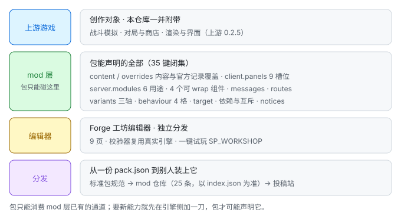

一句话读这张图：**包只能消费 mod 层已有的通道**。想要这一层里没有的能力，正确做法是**在引擎里先加一刀**（加一格开关、一条口径轴、一个槽位、一种模块用途），然后任何包才可能声明它 —— 见 [docs/STANDARD-PACK.md](docs/STANDARD-PACK.md) §五。

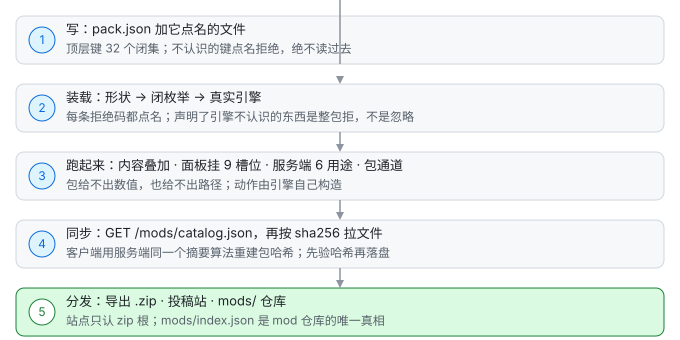

## 一份最小 pack.json（实测能装）

这是**真能装上**的最小包：一个 `pack.json`，没有一行代码、没有一张图。它把界面的调色板换成夜间一套。

```json
{
  "id": "hello-pack",
  "name": "我的第一个包",
  "version": "1.0.0",
  "author": "你的名字",
  "license": "GPL-3.0-or-later",
  "description": "把界面调色板换成夜间高对比一套。",
  "api": ">=1 <2",
  "client": { "theme": { "vars": { "--text-hi": "#f4faf7", "--line": "#2d3d37" } } }
}
```

把它放在 `workshop/hello-pack/pack.json`（**目录名必须等于 `id`**，否则装载器整包跳过并报 `PACK_ID_MISMATCH`），然后：

```bash
node tools/workshop-validate.mjs workshop     # 分层校验：格式 → 语义 → 真实引擎
```

实测输出（本仓库跑出来的原样）：

```
pack hello-pack (我的第一个包)
  OK

behaviour layer (kits/):
  (no kits)

0 error(s), 0 warning(s)
VALID: the engine accepts this content.
```

几条容易踩的：

- **`license` 不能省** —— 缺了会让整个包被加载器拒绝。
- **`client.theme.vars` 的键必须以 `--` 开头**（`^--[A-Za-z0-9_-]{1,64}$`），一个主题上限 200 条；值里不许出现 `;`、`{`、`}`、`<` 和换行 —— 那几个字符能让一条声明**跑出它自己那一格**。
- **只声明 `variants` / `behaviour` / `support` / `playtest` / `dependencies` / `conflicts` 的包会被判 `EMPTY_PACK`**：这六样是「怎么跑」或「和别的包什么关系」的声明，自己不往对局里带东西。要上架得**至少贡献一样真的**（`content` / `client` / `notices` / `routes` / 素材…）。上面这个例子贡献的是 `client`，所以不算空包。
- 顶层键有 **36 个**（`shared/workshop.js:128` 的 `PACK_FIELDS`，实测 36 键）；**不认识的顶层键点名拒绝**（`PACK_UNKNOWN_FIELD`），**绝不读过去**。⚠️ [docs/STANDARD-PACK.md](docs/STANDARD-PACK.md) §二.2 里那张清单与 `docs/SYNC-POINTS.md` 的「今天 35 键」**还停在 35**（`enabled` 那一格是后加的）—— 两份文档的口径**以代码为准**，那两处待同步。

## behaviour：通道已通，表里有 4 格

`pack.json.behaviour` 是**包声明「我要哪一格规则开关、哪一档」**的地方。它今天的样子要写清楚，不然会以为「写了就能用」：

- **通道本身是真的、也是响的**：开关名与选项名都是**闭枚举**，包只能声明引擎表里有的东西；包里**没有数值、也没有路径** —— 动作 `{ kind, value }` **由引擎构造**，`value` 只能来自引擎自己的常量。
- **那张表里有 4 格**：`shared/behaviour.js` 的 `BEHAVIOUR_SWITCHES` 是 `shopBias`（商店出货偏向）/ `prepLoadout`（休整期可更换技能与模组）/ `morphPairing`（变形同构体的配对规则）/ `unequip`（装备拆卸），四格的缺省档都是**引擎今天的行为**（每一格有哪些档、各改了什么，见 [docs/WORKSHOP.md](docs/WORKSHOP.md) §1.22）。一格开关的入场券是「**引擎先有实现点**」，所以每一格与它的实现点**同刀落地**，由维护者点名。
- ⇒ **声明表里没有的开关（或选项）仍会被整包拒**。实测原文（`node tools/workshop-validate.mjs`）：

```
ERROR (record) [PACK_LOAD] BEHAVIOUR_UNKNOWN_SWITCH: behaviour[0].switch "no-such-switch"
is not a switch of this 行为 format. Known switches: "shopBias", "prepLoadout",
"morphPairing", "unequip" — a declaration the loader does not know is never applied,
so it is refused instead of ignored
```

声明长这样（**表里有这几格，所以这是合法写法**）：

```json
"behaviour": [ { "switch": "<开关名>", "option": "<选项名>" } ]
```

- `switch` 必须是非空字符串、`option` 必须是那一格列出的选项名；**可以只写 `switch`**，那就用这一格的缺省（缺省 = 引擎今天的行为）。
- 只允许 `switch` / `option` / `name` / `desc` 四个字段 —— `module` / `entry` / `file` / `path` / `value` / `key` 这类「想改文件、想给数值」的键**在这里就被拒**（`BEHAVIOUR_BAD_SHAPE`）。
- 声明 `behaviour` 任一格的包**必须 `combat: true`**（`BEHAVIOUR_NEEDS_COMBAT`），因为它会改对局结果。
- 两个包声明同一格时，判据**不是**「谁后加载」（那会让结果依赖扫描顺序），而是**包 id 字典序小的赢**，输的一方被点名报告。

加一格开关要一起改哪几处、漏了会怎样、谁拦，见 [docs/SYNC-POINTS.md](docs/SYNC-POINTS.md)。

## 投稿到入库

一份投稿不是「投进来就完事」。它在**两个仓库与一个站点**之间走完这条链：

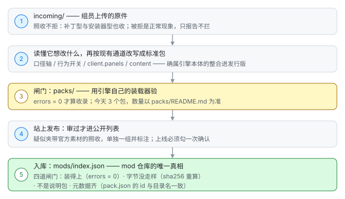

- **七种投稿形态与定级**（① 标准工坊包 ② 包裹式 ③ 补丁型 ④ 安装器型 ⑤ 资源容器型 ⑥ 功能包 ⑦ 声明包）、标准包的四条硬要求、`functional` / `documentation` / `unknown` 判据，都在 [docs/STANDARD-PACK.md](docs/STANDARD-PACK.md)。
- **② 包裹式的差别只在站点那一层**：引擎的装包器**两种都收**（zip 根 → 否则取唯一顶层目录），而投稿站**只认 zip 根** ⇒ 包裹式上传会被 **HTTP 400** 挡下。重新压一次、把包内文件放到 zip 根即可，**内容一个字都不用改**。
- **③ 补丁型与 ④ 安装器型照收**（进 `incoming/`），由维护者按现有通道改写成包 —— **不打回、不删**。「非标准」这三个字**只用来告诉投稿人怎么写**，不是拒收规则。
- **含官方素材的包照收，但必须标注**：包内 `PROVENANCE.md` 与站上备注写明「含官方素材」+ 实测清点 + 版权与用途。上传站是**宽进的漏斗**，仓库是发布物 —— **未标注才是问题**。
- **mod 仓库**（[Stronghold-Protocol-Forge-Mods](https://github.com/XiaMo233M/Stronghold-Protocol-Forge-Mods)）的 `mods/` 存站上已通过成品的**镜像**，`mods/index.json` 是它唯一的真相（四道闸门：装得上 `errors = 0` / zip 字节没走样 / 不是说明包 / 元数据齐）。

## 还不能做什么

这一节和上一节一样重要。**以下都是今天真的做不到的事** —— 写在这里，是为了让「能不能用」有一个当场能查的答案。

| 还不行 | 具体到什么程度 |
|---|---|
| **声明表里没有的行为开关** | 表里 **4 格**（见上一节）：`shopBias` / `prepLoadout` / `morphPairing` / `unequip`。声明别的开关或选项被**整包拒** —— 一格开关的入场券是「引擎先有实现点」，不是「包里写一个名字」。 |
| **在界面上切换一个包的启停** | 引擎**有** mod 登记册（§28.47）＋ 管理器 CLI（`enable` / `disable` / `uninstall` / `rollback`），但**编辑器还没接它** —— 今天看得见启停的只有 CLI、管理器 `list`，以及启动那一行 `[mod-registry] "…" disabled — not loaded`。 |
| **热重载** | **没有**：改了包要**重启服务器**才生效（编辑器的「一键试玩」就是替你起一个子进程）。设计稿 `docs/design/mod-layer.md` 的 "No hot reload" 一条说清了为什么。 |
| **包整份覆盖引擎文件** | 包**不能**覆盖 `data/**` 或 `server/sim/**`，也不能指定任意文件。这不是「还没做」，是**刻意的**：`official` / `config` / `meta` / `shared` / `theme` / `serverModules` 那几格**没有通道**。要这类能力，得在引擎里做成一格开关 / 一条口径轴 / 一个槽位，包才可能声明它。 |
| **从远端 catalog 装包** | 客户端只从**当前连着的这台服务器**同步（`GET /mods/catalog.json`）。**没有**第三方 catalog 源，也没有「从别的站点装一个包」这条路。 |
| **把包裹式 zip 投到站上** | 站点只认 zip 根，套了顶层目录即 **400**（引擎自己两种都收）。重压一次即可，但**站点那一层今天就是这个形状**。 |
| **只放说明的包被上架** | 自述「参考 / 说明 / 装不上是预期」的包**不上架**，但**留在待审、不打回**（它的简介是做兼容包的依据）。 |
| **浏览器端到端测试** | 默认关闭，需要本机 Chrome（`SP_E2E` / `SP_REAL_E2E` / `RENDER_E2E` / `EDITOR_E2E`）。缺 `puppeteer-core` 或 `CHROME_PATH` 时整批**静默跳过**，看起来像「通过了」。 |
| **在 Serverless / 静态托管上开服** | 游戏是单个常驻 Node.js 进程 + WebSocket，只能跑一个实例，必须部署在域名根路径。 |

## 介绍图

`docs/img/intro/` 下是一组可以直接拿去分享的介绍图。图里的界面、数值与分支清单都是**真实截图**（临时起一个工坊包跑出来的），
不是示意图；底图与游戏画面来自本仓库的 `public/assets/` 与 `docs/img/`，版权与使用限制同下方声明 —— **不适用 GPL，仅供非商业展示**。

> 前面那三张**自绘的能力图**（`docs/img/cap-01-layers.svg` · `docs/img/cap-02-pack-lifecycle.svg` · `docs/img/cap-03-submission-pipeline.svg`）与这里不同：它们只由本项目自己的文字与方框组成，**适用 GPL-3.0-or-later**。

<p align="center">
  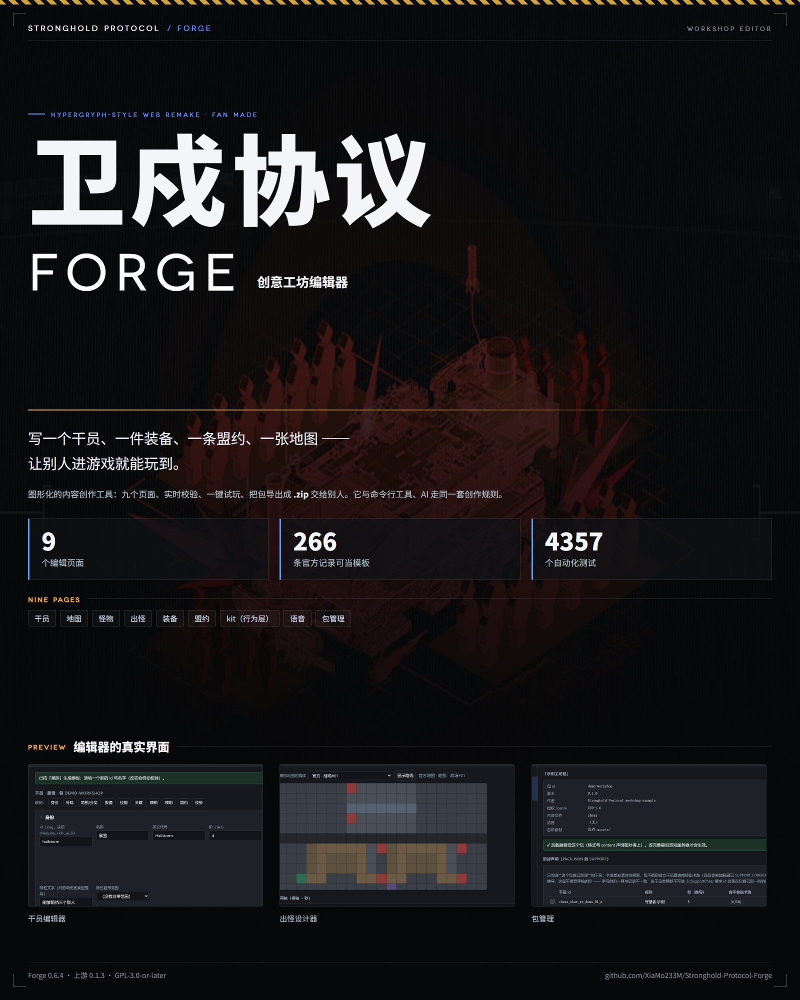
</p>

| 从一行描述到别人进游戏 | 仓库里还有完整的游戏本体 |
|---|---|
| [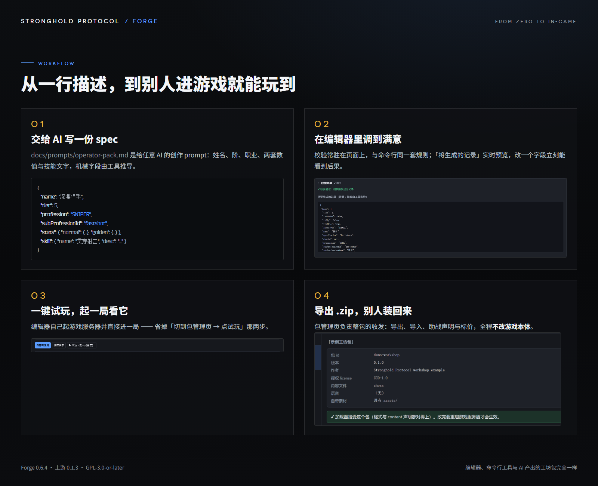](docs/img/intro/04-workflow.png) | [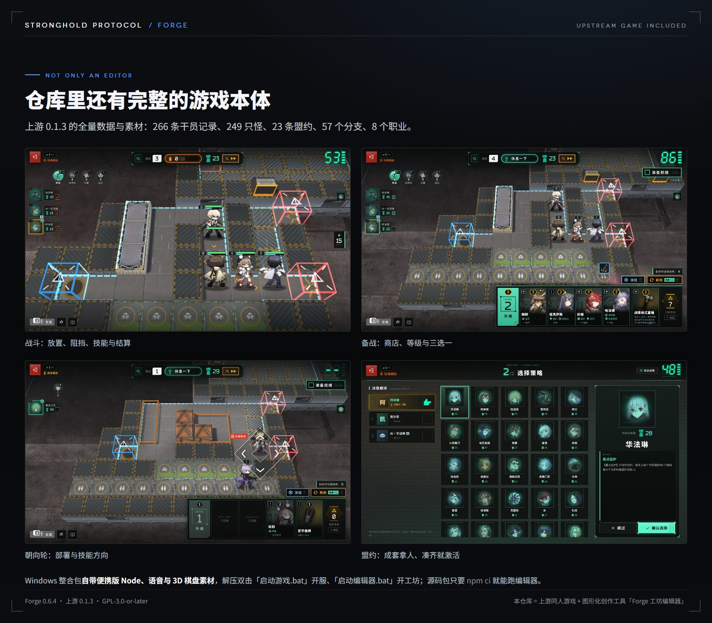](docs/img/intro/05-upstream-game.jpg) |

<details>
<summary><b>长图一：九个页面，把一局游戏拆开给人改</b>（点开看，1600×3260）</summary>

<br>

[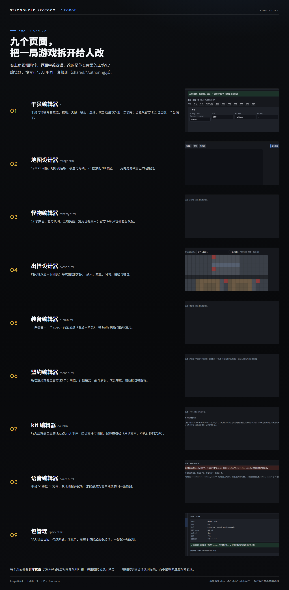](docs/img/intro/02-nine-pages.png)

</details>

<details>
<summary><b>长图二：干员编辑器 —— 分支跟着职业走、攻击范围自己画、数值一键按官方中位填入、保存旁一键试玩</b>（点开看，1600×3240）</summary>

<br>

[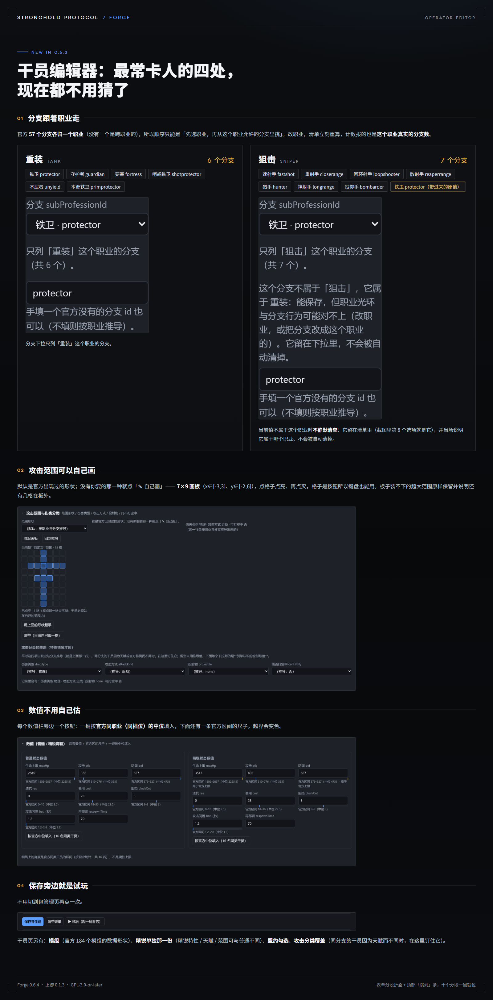](docs/img/intro/03-operator-editor.png)

</details>

## 快速开始（编辑器）

**一键启动（推荐）**：双击 **`scripts\start-editor-windows.bat`**（Windows）/ 运行 **`./scripts/start-editor.sh`**（macOS / Linux）。它们会检查 Node、首次自动装依赖，然后启动编辑器并在浏览器里打开 <http://127.0.0.1:3311>。**不需要先下载素材、也不需要开游戏服务器。**

用发行页的**零安装整合包**时同理：解压后双击包根目录的 **`启动编辑器.bat`**（游戏是 `启动游戏.bat`）。

手动 / 脚本化：

```bash
npm run editor                       # 打开工坊编辑器（独立工具，默认只绑 127.0.0.1）
node tools/workshop-validate.mjs workshop                     # 分层校验整个工坊目录
node tools/workshop-scaffold.mjs docs/examples/operator-spec.json --pack my-pack   # spec → 合法工坊包
node tools/workshop-pack.mjs export my-pack                   # 把包导出成一个可分享的 .zip
node tools/workshop-pack.mjs import ~/Downloads/my-pack.zip   # 把别人的包装回来（--force 覆盖同名包）
```

- 也可以直接 `node tools/workshop-editor.mjs --port 3400 --open`，或用 `--workshop <目录>` 指定其它工坊目录。
- **默认只绑 127.0.0.1**（编辑器可以写文件）；要绑局域网需要显式 `--host`，此时会打印警告。**没有登录、没有权限控制**，不要暴露到公网。
- **无构建步骤、无新依赖**：纯 Node `http` + 原生 ES 模块 UI。**不需要改游戏服务器**。
- 它只写这些路径：`workshop/**`（spec 源文件与生成产物）与 `data/support.json`（只在动「是否助战」开关时）；`tools/build-data.mjs` 生成的其它 `data/*.json` **永不改动**。
- ⚠️ **`packs/` 是语言包目录，不是工坊包目录**：它是上游的 **content pack**（`packs/<id>/pack.json`，本版只加载 `lang` 语言包，索引 `GET /packs/index.json`），**与工坊包是两套机制、两个索引**。装别人的模组请放进 `workshop/<包 id>/`（或把 `.zip` 拖到 `安装工坊包.bat` 上）—— 往 `packs/` 里放模组**不会生效**。见 [docs/PACKS.md](docs/PACKS.md) 与[项目结构](#项目结构)。
- 保存后需**重启游戏服务器**才会出现在游戏里；**包管理页的「启动试玩」会替你做这件事**——它起一个游戏服务器子进程（绑本机随机空闲端口、读你当前的工坊根），并打开浏览器直接进一局独立模拟。改完包再点一次（「重启试玩」）即可。

## 设计上的两条硬规矩

### 一、只编辑人能给的，机械字段一律推导

手写派生字段会让数据与引擎不一致，而且游戏里不会报错。所以编辑器只让人填「人能决定的东西」，其余全部由服务端按真实引擎推导：

| 内容 | 作者填 | 一律推导（绝不手写） |
|---|---|---|
| 干员 | 身份、两套数值、技能、天赋 | **精锐一对**：`chess_ws_<slug>_a`（普通）+ `_b`（精锐），两条记录成对生成、成对删除 |
| 地图 | `rows`（网格）、`tiles`（字符 → 地形图例）、`devices`（装置）、路线 | `groundPaths` / `groundPathsWithDevices` / `deployTiles` —— 由 `server/stageAuthoring.js` 复用 `server/sim/grid.js` **模拟器自己的寻路**算出（路线本身也按引擎的流场寻路，画的是实际走法） |
| 怪物 | 17 项数值、能力说明、天赋黑板、技能、免疫、复用美术 | `attrPower` 与 `be`（`be` 决定阵营换怪时替换多少只，所以必须算，不能手填） |
| 出怪 | 时间 / 敌人 / 数量 / 间隔 / 路线 / 槽位 / 不计入 | `totalCount` 与 `slotCounts`（两者**不对称**：`slotCounts` 计入 `unharmful` 的出怪，`totalCount` 不计入） |
| 装备 | 身份、buffs 黑板、复用的图标 `trapId` | `params`、`mergeable`、`shopExcluded` —— 三条推导精确复现官方全部 115 条装备（`test/itemAuthoring.test.js`） |
| kit（行为层，手写文件） | 代码 | 钩子词表 + 三条硬规则（`shared/kitAuthoring.js`）：**必须自己给 `skill`**、**自包含不 import 引擎模块**、**会在玩家浏览器里执行** |

### 二、校验器复用真实引擎

`tools/workshop-validate.mjs` 是**分层校验**：格式 → 语义 → 真实引擎 → 每种内容一层（`kits` / 地图 / 怪物 / 出怪 / 装备）。地图层会**重算并比对路径表**，怪物层重算 `be` / `attrPower`，出怪层重算 `totalCount` / `slotCounts` 并检查每只敌人的键与 `routeIndex`，装备层重算 `params` / `mergeable` / `shopExcluded`。

编辑器、CLI 与 AI 共用同一批 `shared/*Authoring.js`（干员 / 地图 / 怪物 / 出怪 / 装备 / kit），所以**规则不会漂移**：编辑器里能保存的内容，校验器一定也接受，反之亦然。

## Option 署名

编辑器保存的**每一个 Option**（干员、地图、怪物、出怪、装备的 spec）都会自动带一个 `_meta`：作者、创建时间、来源、著作权声明、反打包转售声明 —— 声明写在 README 里不会跟着文件走，而一份被拷到别处的关卡文件必须自己说明它是谁做的。

- **`created` 只写一次**，之后再保存只更新 `modified`。
- **`_meta` 只存在于 spec（源文件）里，绝不会进入游戏读的产物**（`test/forgeNotice.test.js` 钉住了这条）。
- **行为层 kit 是 `.js`，写的是一行注释头**（`// @forge created=… author=…` + 声明全文）：JavaScript 里没有可以挂 `_meta` 的数据对象。规则相同 —— `created` 只写一次、只补写缺失的头、不动你自己写的注释（`test/kitEditor.test.js` 钉住了这条）。
- 作者名按 `createEditorServer({ forgeAuthor })` → `SP_FORGE_AUTHOR` → 该包 `pack.json` 的 `author` 取；都没有就写「未署名 (anonymous)」，不猜。

字段结构与边界详见 [docs/EDITOR.md](docs/EDITOR.md)，法律文本见 [著作权声明](#著作权声明)。

## 工坊与助战

> [!NOTE]
> 以下是**本项目自行新增**的功能，不是官方内容，也不在 `tools/build-data.mjs` 的生成范围内。它不修改 `data/*.json`。

这一节讲**逐条细节**；「包到底能碰到哪些东西」的完整清单在上面的 [Forge 现在能干什么](#forge-现在能干什么)。

- **助战**：每名玩家每阶可选 n 个助战干员，**卡池由服务端控制**（`data/support.json`），不在卡池中的即禁用。
- **创意工坊**：把工坊包放进 `workshop/<包>/`，即可新增/覆盖干员等内容。官方数据保持字节不变。
- **工坊语音包**：包可以在 `pack.json.voices` 里给自己的（或助战的）干员配语音，音频放在包自己的 `assets/` 下；客户端不需要任何新通道就能听到——叠加层把台词并进它本来就在读的 `assets.audio.voice`。**0.7.3 起还能逐语种各配一份**（`pack.json.voiceLangs` → `assets.audio.voiceLangs[<语言>]`）：玩家在设置里选了中文，就听这个包的中文那一条，缺这一句时照旧退回默认配音。只带语音、不含任何数据文件的包是合法的。见 [docs/WORKSHOP.md](docs/WORKSHOP.md) §1.4。
- **包自带助战**：`pack.json.support` 列出本包自己新增、应当进助战卡池的干员 —— 装包即可选，不必再手工改 `data/support.json`（阶由记录推导；安装方可用 `"workshop": false` 关掉一切包的声明）。见 [docs/WORKSHOP.md](docs/WORKSHOP.md) §2.1。
- **包自带图标**：`pack.json.bondIcons` 给盟约配图、`pack.json.itemIcons` 给装备/道具配图（包新增的盟约与装备原本只能显示圆点/兜底图）；图放在包自己的 `assets/` 下，加载时并进合并后的 `assets.json`（`bonds` / `items` 两张表），客户端不需要任何新通道。只带图标的包同样合法。见 [docs/WORKSHOP.md](docs/WORKSHOP.md) §1.4。
- **包自带外观素材**（0.8.0 起）：`pack.json.art` 让包带上**头像 / 立绘 / spine 模型**（`chars` / `enemies` / `tokens` 三张表，形状照官方条目抄），加载时并进 `assets.chars` / `assets.enemies` / `assets.tokens` —— 于是**包新增的干员/怪物不再是一张菱形贴图**，客户端同样零改动。干员页与怪物页各有一块图形入口：从本包真实素材里挑、**选完 `.skel` 自动填同目录同名的 `.atlas`**（这条是硬约束：加载器是从 skel 路径推 atlas 的）、动画名从骨架里真实存在的名字里选。见 [docs/WORKSHOP.md](docs/WORKSHOP.md) §1.4。
- **把包交给别人 / 装别人的包**：`node tools/workshop-pack.mjs export <包>` 打成一个 `.zip`，对方 `import` 即装；整合包里更简单——**把 `.zip` 拖到 `安装工坊包.bat` 上**。装包只写 `workshop/<包>/`，不碰 `data/*.json`。见 [docs/WORKSHOP.md](docs/WORKSHOP.md) §1.5。
- **包在界面上加东西**（`client.panels`）：9 个槽位任选，从大厅浮层到商店卡、到对局 HUD。`screen.game.shopCard` 是**可重复宿主** —— 引擎每张商店卡渲染一个容器，面板挂进**每一个**，并用 `ctx.hostKey`（商店卡那个键就是干员 id）认自己那一份；这正是「每张卡上一个标记」和「屏幕上有一个标记」的差别。面板拿到的注入面是**冻结的**：只读会话态 `ctx.me` + 它自己声明的样式表 / 数据表 / 通道，**没有** store、没有 match 对象、没有 audio。见 [docs/MOD-SURFACE.md](docs/MOD-SURFACE.md) 的 C 层。
- **包改写引擎自己的界面**（`client.panels[].wraps[]`）：4 个组件（`game.bondStrip` · `game.hud.topBar` · `game.shopCard` · `loadout.detail`），两种模式 —— `wrap` 拿到引擎那一份的 `orig` 包住它，`replace` 整段换掉（`orig` 是 `null`）。任一环抛错或返回空：**退回下面那一份**并点名一次，屏幕照旧。见 [docs/design/mod-layer.md](docs/design/mod-layer.md) §28.19。
- **包在服务端跑代码**（`server.modules[]`）：6 种用途，其中 `matchClass` 是唯一能改对局结果的那一种（所以声明它**必须 `combat: true`**）；声明过 `write` 的模块拿到**只属于自己包**的一个目录（`<状态目录>/mod/<包id>/`，永不与别的包共享）。见 [docs/MOD-SURFACE.md](docs/MOD-SURFACE.md) 的 B 层。
- **包与自己的面板通信**（`messages`）：一条通道的线上名是 `<包id>.<短名>`，服务端侧唯一由消息驱动的调用点是 `Match.handlePackMsg(playerId, msg)`，它在 `pack.msg` 限流之后、转发之前被调到一次。见 [docs/design/mod-layer.md](docs/design/mod-layer.md) §28.14。
- **包自带素材源**（`assets.mirrors`）：作者可以自备 CDN 承载**本包自己的容器**。它是「素材加载源」这一格的唯一入口，纪律很硬：`base` 必须是绝对 https，`sha256` 必须等于装载期从包内文件算出的容器摘要 —— 对不上的那一条**停用并点名**（**不拒包**），而服务端**不会为这条通道发一次网络请求**。见 [docs/design/mod-layer.md](docs/design/mod-layer.md) §28.40。
- **包发公告**（`notices`）：一段结构化文本（公告 + 鸣谢），与引擎自带公告、其它包的公告**追加合并**，互不覆盖；纯文本、零代码的包因此也是合法包。见 [docs/WORKSHOP.md](docs/WORKSHOP.md) §1.13。
- **包把数据挂成端点**（`routes`）：`{ path, file, cache }`，缓存策略取自引擎自己的那一份清单。见 `server/http/routeMount.js`。
- **包选一套口径**（`variants`）：3 条轴 `training` / `form` / `deploy`，每条轴**必有「官方那一档」**，缺省就是引擎今天的行为。见 [docs/design/mod-layer.md](docs/design/mod-layer.md) §28.39。
- **包声明一条规则开关**（`behaviour`）：通道已通、守卫已就位，**表里有 4 格**（`shopBias` / `prepLoadout` / `morphPairing` / `unequip`，缺省都是官方那一档）—— 见 [behaviour：通道已通，表里有 4 格](#behaviour通道已通表里有-4-格)。
- **客户端按哈希同步一个包**：`GET /mods/catalog.json` 给出每个包**每个文件**的 `path` / `bytes` / `sha256`（磁盘字节）与 `canonical`（进包哈希的那一份）；客户端用**与服务端同一个** `modManifestDigest` 重建包哈希，并发 4、单文件重试 2 次、30 秒超时，**字节先验哈希再落盘**（坏文件永不写进缓存）。见 `server/modCatalog.js` 与 `public/js/mods/sync.js`。
- **大厅与房间**（本项目新增，不是官方内容）：房主建房间时用**座位上限滑杆**选本房开几张座位卡（滑杆本体 `public/js/screens/lobby.js:339` 的 `<input class="seat-cap__slider" type="range">`，读数与钳位在 `:298` 的 `seatCapRange` 与 `:330` 的 `SeatCapPicker`；**天花板由服务器握的 `SP_MAX_SEATS` 决定**，见[端口与配置](#端口与配置)）；**快速匹配**走 `public/js/screens/lobby.js:652` 的按钮与 `server/matchmaking.js`（`MATCHMAKE_DEFAULTS` 在 `:60`），队列仍是**一间官方房 4 人**；**房间模组回显**是房间自己声明的集合，与 `welcome.mods` **同一个形状**（服务端 `server/lobby.js:443` 的 `room.state.mods`，界面 `public/js/screens/room.js:386`「本房间使用模组（n 个）」）；等待室里另有常驻**聊天**面板（`public/js/screens/chat.js:61` 的 `ChatPanel`）。

```bash
node tools/workshop-scaffold.mjs docs/examples/operator-spec.json --pack my-pack   # spec → 合法工坊包
node tools/workshop-validate.mjs workshop                                          # 分层校验（含真实引擎）
node tools/workshop-pack.mjs export my-pack                                        # 包 → 可分享的 .zip
node tools/workshop-pack.mjs import ~/Downloads/my-pack.zip                        # .zip → workshop/my-pack/
npm run editor                                                                     # 打开工坊编辑器（独立工具）
```

**客户端不需要、也不会包含编辑器**：`editor/` 不在 `public/` 下，游戏服务器无法把它发给网页端或后续打包的 APK。
详见 [docs/WORKSHOP.md](docs/WORKSHOP.md) 与 [docs/EDITOR.md](docs/EDITOR.md)。

### UI-Hub 层：大厅 / 房间 / 编队那一层的一次换新

大厅那一层的整体观感来自第三方 UI 包 `ui-hub-package-20261013`。它**不是以工坊包的形式装进来的**，而是把其中五样**并进引擎源码**（另外两段 CSS 整份并进 `lobby.css` / `loadout.css`）：

| 模块 | 是什么 |
|---|---|
| `public/js/ui/hubBackdrop.js` | 大厅背景层与它的设置对话框 |
| `public/js/ui/protocolScene.js` | 顶栏里的协议场景 |
| `public/js/ui/matchFlow.js` | 匹配流；**声明了但只在大厅挂载** —— `SearchPanel` / `FoundPanel` 不进对局 |
| `public/js/ui/transitions.js` | 大厅背景对话框的**离场**动画（220 ms，复用引擎既有的 `rd-close`，不自造关键帧） |
| `public/js/screens/sweep.js` | S.W.E.E.P. 报告入口 |

- 哪些垫片被丢掉、哪些**声明了但未启用**，逐条记在 [docs/design/client.md](docs/design/client.md):156-178（§10）。
- **三视口预算**：这一层的高度预算按 **1440 宽下的 720 / 768 / 900 三档高**实测钉住 —— 720 高时模式卡底边 732、判据上限 700（差 32 px），900 高时富余 62 px；所以 **`max-height: 860px` 以下不挂**两件占掉净空的装饰（`.lobby-proto-stage` 与创建框里的 `.hub-art--create`，合计 52 px），860 以上整层照挂。数字、理由与「只由 CSS 决定可见性」写在 `public/css/screens/lobby.css:327-337`。

**2026-10-14：换成 `ui-package-20261014`（同一口径：包版作底、我们的增量追加在它的末尾）。** 包版把整份替换的五个文件又推进了一版（它的 `lobby.css` 涨了 38,958 B），我们独有的七项（座席上限滑杆 / 快速匹配 / 房间模组回显 / 助战 / 聊天 / 添加·移除 AI 队友 / i18n 包装）逐条移植回去，**`shared/protocol.js` 一字未动**。新能力四项：

- **大厅自定义 BGM**（`public/js/ui/lobbyMusic.js`）：玩家在大厅顶栏 ♫ 里导入一首音乐当大厅 BGM（≤ 20 MB，存本机 IndexedDB），大厅 / 房间 / 战前信息 / 选人时续播，进战场淡出并交回游戏 BGM。它靠 `public/js/audio.js` 的 `playBgm` 里两条**可选钩子**接管；模块不加载时钩子是空的，游戏 BGM 行为与原来逐字相同。
- **异形屏适配**（`public/js/ui/screenFit.js` + `public/css/devices.css` 末尾一段）：刘海 / 圆角屏玩家在设置里按四条边各调 ±100 px（50 = 不调整），只存本机（`sp.pref.screenFit`）；它写在 `<html data-fit>` 上，`.app-root` 因此成为内缩盒。
- **成就奖杯等级徽章**（`public/js/ui/trophies.js`）：按累计奖杯数取官方棋子徽章。**本仓库没有账号服务**（`ui/achievements.js` 是返回 `null` 的垫片）⇒ 没有奖杯数来源时该徽章不显示；美术缺失时回退自带 SVG 车。
- **名片立绘 / 名片背景 / 好友 / 成就面板**：这些模块已按包的规范装上，但依赖本仓库不存在的账号与协议面 —— **`ui/seatArt.js` 的「名片干员」需要协议 `room.card`，而本仓库的 `shared/protocol.js` 里没有这一条 ⇒ 该模块静默不启用**（不报错，只用按玩家 id 选出的回退立绘）；`ui/namecards.js` / `ui/friends.js` / `ui/achievements.js` 则是返回 `null` 的垫片，界面上不出现对应入口。

逐条口径记在 [docs/design/client.md](docs/design/client.md)（§10 末尾）与 [CHANGELOG.md](CHANGELOG.md) 的 `0.18.5` 节。

## 本仓库完整包含上游游戏

下面是本仓库**一并附带**的上游游戏：**卫戍协议：盟约 · Stronghold Protocol: Alliance**（非官方同人复刻）。它是这套编辑器的创作对象 —— 编辑器写出的内容，最终在这里跑起来。

### 简介

「卫戍协议：盟约」是自走棋 + 塔防：休整期在调度中心招募干员、摆阵、配装备，作战期干员自动部署，迎击从红门涌来的敌人，漏过去的敌人扣目标生命值。本项目在浏览器里复刻了这一玩法，规则和数值尽量对照官方数据表与 PRTS 核对。

- **独立模拟**（单人）与**同盟模拟**（1–4 人**合作**，没有 PvP；空位可以加 AI 队友）。
- 服务器是一个 Node.js 程序，**战斗在各玩家的浏览器里模拟**（和官方一样），服务器只管经济与回合，一台低功耗小主机就能开服。
- **本仓库打包的上游游戏本体为 0.3.0**（本仓库自己的版本是 0.19.1，两者的读法见[版本号怎么读](#版本号怎么读)）：0.2.0 带来补位、自选编队、中英日韩四语言、自定义快捷键与精简包；0.2.1 把联防改回在本回合的战场上打（0.2.0 那张空马路是所有波次模板共用的占位地图）、装备栏满时再装一次性道具会弹「替换装备」窗，并修掉凋亡扣技力、频次器物、飞行敌人高度、盟约栏与详情卡等一批问题；**0.2.2 把干员的潜能与练度改成按干员、按玩家在运行时设置**（缺省满潜，比 0.2.1 一律满潜的数值再高约 10 %）、新增**日文语音**与本机**统计页**、补上装置说明卡与详情卡攻击范围等界面项，并把协议里 `loadout.ops`、`b.progress` 的 `resolved` / `leaksBy` 等字段补齐，详见 [CHANGELOG.md](CHANGELOG.md) 与 [docs/history/0.2.2.md](docs/history/0.2.2.md)。**0.2.3**：新增六星干员**克莱门莎**（三个技能、两项天赋）、**黍「好时节」与乌尔比安「前路」模组**、**四档界面文字大小**、**逐干员配音语言**、**添加到桌面**、**开局重随**与**恢复本机对局**，详见 [docs/history/0.2.3.md](docs/history/0.2.3.md)。**0.2.4 再抬一级**：按官方补齐**共享卡池与全队共享的装备库存**（同盟为单人的 2 倍，部分特殊装备例外；普通 / 进阶装备分别占 1 / 2 份，商店展示不占份数，消耗、销毁、出售和淘汰都归还份数），修正突袭成员复活后的重新选敌，以及联机首领 / 隐秘首领战中突袭可以跳到空半场的正常部署格（#475），并修正克莱门莎二技能溅射、浊心斯卡蒂与坚守的伤害分摊、哈洛德二技能的元素损伤判定、涤火杰西卡盾牌的相邻四格、家族徽章解除隐匿后的首笔伤害、松果二技能的逐次部署成长，日语界面改用官方日服用语，详见 [CHANGELOG.md](CHANGELOG.md) 与 [docs/history/0.2.4.md](docs/history/0.2.4.md)。**0.2.5 再抬一级**：**驭械术师的浮游拆成本体一击 + 未释放浮游的附加伤害**（洛洛二技能在目标离开攻击范围后继续锁定）、受击格改用官方**四舍六入五成双**并把被挡在场地边缘的敌人按在边线内侧那一格、新增**官方伤害数字**（默认关闭）、**盟约叠层提示音**、**每局随机的首领配对**与按团队权益保留的 Touch 外勤医疗，并让**固定赠品不再被共享库存阻断**，详见 [CHANGELOG.md](CHANGELOG.md) 与 [docs/history/0.2.5.md](docs/history/0.2.5.md)。**0.2.6 再抬一级**：**减轻开服电脑的流量**（静音时不下载背景音乐、1 KB 以上的 WebSocket 消息压缩、素材地址带内容哈希长期缓存、brotli 压缩、教程图改用 WebP、`/healthz?traffic=1` 与诊断里的下载量）、**官方场景光照改回官方值**（显示官方场景时不再明显偏暗）、显示官方场景时**补画射击台 / 特制水上平台 / 封印的地面**、最后一个还没选策略的玩家**不再看到可点的「跳过」**、**每回合开始按部署顺序重播入场动画与落地音**、设置新增**「弹药数量」**（默认关闭），并修掉单位多时模型被裁切与残留错位像素（#557 / #549 / #569 / #546 / #416 / #552 / #542），详见 [CHANGELOG.md](CHANGELOG.md) 与 [docs/history/0.2.6.md](docs/history/0.2.6.md)。仍有少数规则按推断实现，与官方不一致的地方欢迎在 Issue 里反馈。
- **多语言配音**（0.7.1 起）：干员战斗语音有中文 / 日文 / 英文 / 韩文四种，**设置 → 配音语言** 选全局默认，
  任何干员还能在 **干员详情 → 配音** 里单独换一种（点一下当场试听）。某种配音缺一句时自动退回默认配音。
  **发行包只带默认配音**（**0.9.0 起是日文**），其余三种在同一个 release 的 `…-voices-*.zip` 里（解压覆盖到 `app/public/assets/audio/voice/` 即可，不用改配置）。
  **工坊包也能逐语种配音**（0.7.3 起，`pack.json.voiceLangs`）：选了哪种语言就听这个包的那一份，缺这一句时退回默认配音，
  见 [docs/WORKSHOP.md](docs/WORKSHOP.md) §1.4。

下面是给作者做参照的游戏画面。

| 同盟房间 | 策略轮选 | 休整期（商店 / 盟约） |
|---|---|---|
|  | 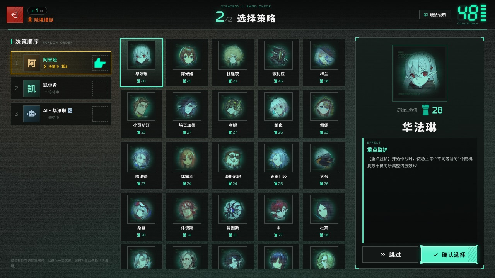 |  |
| **部署方向轮盘** | **作战** | **最终攻势** |
| 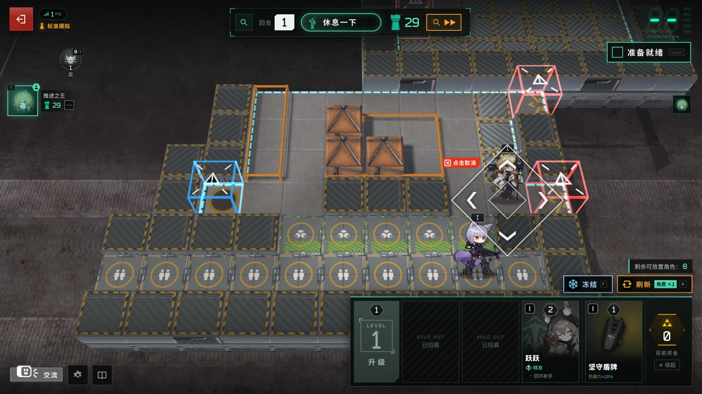 | 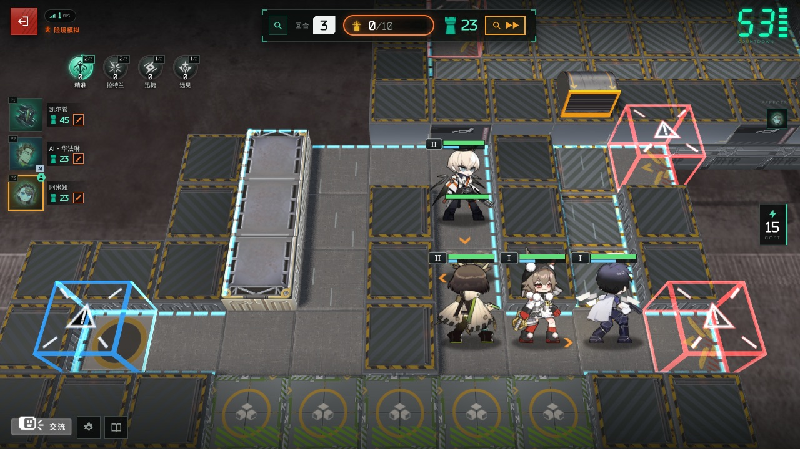 |  |

### 功能一览

- **完整的一局**：确认本局信息 → 策略轮选（40 名策略）→ 14 回合 → 结算称号；险境及以上满足条件时进入第 15 回合「隐秘核心」。
- **4 种难度**：标准 / 险境 / 绝境 / 终极，独立与同盟各一套参数，均取自官方数据。
- **休整期**：招募、刷新、冻结、升级调度中心；整备区与临时整备区；从整备区拖到棋盘部署，用**方向轮盘**选择朝向。同盟模拟的卡池共用。
- **晋升精锐**：3 名同名干员自动合成精锐，并获得一次高一阶的免费招募。
- **干员与调配**：112 名可招募干员（+ 精锐）及其技能、天赋和特质；开局前可以为每名干员选择携带的技能（283 个技能全部手工实现）和精锐的模组。
- **补位（0.2.0）**：在「干员调配」标出自己没有的干员，开局后这些干员由官方的**补位干员**上场（8 名预备干员，以及郁金香、Sharp、Mechanist、Stormeye、Pith、Touch、Raidian、Misery、领主·Sharp），盟约、特质、阶级、价格与合成都仍按原干员；商店、手牌、棋盘与详情卡上带一个「替补」标记，作战中用自己的语音。
- **自选编队（0.2.0）**：5 阶、6 阶各选 2 名自己拥有的 6★（71 名可选，三个技能任选、精锐可选模组），调度中心升到 5 / 6 级后这些干员只出现在你自己的商店里（每人单独的库存，不进公共卡池），带召唤物的干员放下后召唤物按官方数量进手牌。
- **多语言（0.2.0）**：标题页与「设置」里切换中文 / English / 日本語 / 한국어 / 繁體中文；干员、技能、敌人、盟约等游戏文本用各服官方数据，界面译文另有语言包机制（`packs/<lang>/`，[docs/I18N.md](docs/I18N.md)）。
- **自定义快捷键（0.2.0）**：「设置 → 快捷键」里改刷新、冻结、升级、撤退、出售与准备就绪的按键，冲突时两者互换，可恢复默认。
- **盟约与层数**：23 个盟约（8 个势力核心盟约 + 附加盟约），层数整局保留，每个盟约最多 999 层。
- **装备与机变**：装备与法术，同名装备合成、特定组合赋予盟约效果；已配发的装备锁定在干员身上。部分回合开始前有机变选卡（装备、资金、干员、层数、悬赏等）。
- **自动作战**：技能按官方「技能策略」自动释放；按接触半径阻挡，阻挡者倒下时由接触的干员接替；元素损伤与元素爆发；召唤物由玩家手动摆放；推开 / 拉拽按力度与重量计算；被击倒的干员留在原地显示再部署倒计时。
- **地形与敌人**：阻隔工事、射击台、源石流吹风机、沼泽、排气格栅、涨潮等地形装置；空中与近地悬浮敌人、悬赏敌人。
- **联防**：有人漏怪、又有人完美作战时，完美作战的队友带着阵容帮忙拦截漏掉的敌人。
- **最终攻势与隐秘核心**：两人共享一个战场，全队共同削减同一条领袖血条；10 个敌方领袖，巨型领袖约 5×3 格的受击范围，以及官方的限伤规则。
- **结算称号**：卫戍之星、不朽盟约、坚若磐石等 6 个称号。
- **断线重连**：同盟模拟断线后 10 分钟内重新打开页面即可回到原座位，掉线期间按原阵容自动作战，也可以「暂离」交给 AI 托管；独立模拟 24 小时内可以回来继续（同一个浏览器）。
- **交互细节**：漏怪时顶栏的目标生命值实时减少（结算时确定）；点选、拖放和配发装备都按地上的方格；购买、升级和机变选卡都需要点两次确认；只有一名玩家时除作战外不计时。
- **画面与声音**：真实 Spine 小人、官方 BGM 与音效、表情（6 套 × 6 个）、作战特效；可选的官方 3D 棋盘（需要从本机客户端提取贴图）。
- **手机与电脑**：触摸拖拽、长按查看详情，推荐横屏；设置里可以调低画质。

### 快速开始（游戏）

发行页上的两个包对应下面两种方式，按需选一个即可。

#### 方式一：零安装整合包（Windows x64，推荐）

**不需要装 Node、也不需要再下载素材**：包里自带便携 Node 22，解压后双击 `启动游戏.bat` 就会启动服务器并打开浏览器。

1. **下载**：在 [Releases](../../releases/latest) 页面下载最新版本的 **`…-win-x64.zip`**（含全部素材，较大；确切大小与 sha256 见发行页）。
2. **解压**到一个路径较短、**不在 OneDrive 同步范围内**的文件夹，例如 `C:\Stronghold-Protocol`。
3. **双击包根目录里的 `启动游戏.bat`**。Windows 防火墙弹窗请勾选「专用网络」并允许；关闭窗口即停止服务器。想开工坊编辑器就双击同一个目录里的 **`启动编辑器.bat`**（不需要先开游戏服务器）。
4. 浏览器会自动打开 `http://localhost:3000`。窗口里列出的局域网地址可以直接发给同一网络的朋友。

包内含编辑器、`docs/prompts/` 官方 prompt、全部公开镜像素材，以及从本机客户端提取的官方素材：**官方 3D 棋盘**、官方界面底板、灼热 / 炽焰源石虫的官方模型。素材版权归上海鹰角网络 / Yostar，**仅限非商业使用**，包内附 `NOTICE.md` 与 `THIRD-PARTY-NOTICES.md`。**角色语音台词也在包里**：191 名干员的 2674 条战斗语音（行动出发 / 行动开始 / 选中 / 部署 / 作战中 1-4 / 四种结算），游戏里**默认就能听见**（设置 → 干员语音 = 0.8）；每个干员的战斗音效（攻击 / 受击 / 技能）同样齐备。

**已经装好上一个版本的话，不用重下整包**：每个版本还会附一个 **`…-update.zip`**（0.8.2 起），只含比上一版改动过的文件。停止游戏、把它解压覆盖到安装目录、再照常启动即可 —— 启动时服务端会先按 `MANIFEST.json` 校验程序文件、把新版本不再需要的旧文件删掉（**你自己改过的文件不会被删**），校验不过会提示去下完整包而不是带着半个坏包装起来。用法与边界见 [docs/DEPLOY.md](docs/DEPLOY.md)。

macOS / Linux 请用方式二。

#### 方式二：源码包 / 从源码运行（不含素材）

包里只有代码，素材在首次运行时从公开镜像下载（约 550 MB，可中断续传）。

```bash
unzip Stronghold-Protocol-Forge-*-src.zip     # 或 git clone 本仓库
cd Stronghold-Protocol
npm install        # 安装依赖（postinstall 会把 pixi / preact / three 复制到 public/vendor）
npm run setup      # 检查环境，并从公开镜像下载约 550 MB 美术 / 音频（可中断，再次运行会续传）
npm start          # 启动服务器：http://localhost:3000
```

也可以直接运行启动脚本（Windows `scripts\start-windows.bat`，macOS / Linux `scripts/start.sh`）：首次会自动安装依赖、下载素材，然后启动服务器并打开浏览器。

- **本地客户端素材（可选）**：官方 3D 棋盘、部分官方界面图标（交流按钮与表情面板的边框、模组类型图标等）和灼热 / 炽焰源石虫的官方模型需要从本机的《明日方舟》PC 客户端提取（Windows 原生客户端、macOS 的 CrossOver 或 PlayCover）。`npm run setup` 检测到客户端时会询问是否提取（需要 Python 3.8+，依赖装在项目内的 `.venv-extract`，不影响系统）；之后可以用 `node tools/setup.mjs --local` 重新提取，或用 `--game "<…/StreamingAssets/AB/Windows>"` 指定路径。没有客户端时游戏照常运行，这几样换成替代样式：2D 棋盘、样式相近的图标、染色的普通源石虫。表情和「玩法说明」的教程图随上面的素材一起从公开镜像下载，不需要客户端。没有客户端的服务器（例如 Linux VPS）也可以从**同一版本**的整合包里复制 `public/assets/local/` 和 `data/local-assets.json`，见 [docs/DEPLOY.md](docs/DEPLOY.md) 的「本地客户端素材」。
- **素材下载优先使用 GitHub**，失败时自动改用 jsDelivr 镜像。
- **干员语音台词（可选，默认关闭）**：`node tools/fetch-assets.mjs --voices` 额外下载**约 46 MB** 的角色语音（实测 1848 个文件，120/138 名干员有战斗台词），装好后在「设置 → 干员语音」调高音量即可。**不加这个开关时一切照旧**：不下载、不写进清单、客户端也不请求。细节（槽位、`#` 文件名、URL 编码）见 [docs/ASSETS.md](docs/ASSETS.md) 的「Voice lines」；**工坊包自带的语音**（助战干员的配音）走同一条链路，见 [docs/WORKSHOP.md](docs/WORKSHOP.md) §1.4。
- `npm run doctor`（即 `node tools/doctor.mjs`）可以随时诊断：Node 版本、素材是否完整、端口占用、局域网地址和防火墙。

#### 本地美术 `public/assets/local/**`：官方素材、只在本地、不随源码分发

这一层是**从本机《明日方舟》客户端提取的官方素材**，和上面从公开镜像下载的那一批**不是一回事**：

- **不进版本库**：`.gitignore:10` 把整个 `public/assets/` 排除在外 ⇒ 仓库源码里**没有**它，`git clone` 也拿不到；源码包 / 精简包首次启动**不会**下载它（setup 只下载公开镜像那一批）。**只有发行版完整包**（打包机上已经提取过时）才带。
- **本机这一份实测**（`data/local-assets.json` 的 `groups` 与磁盘逐项对照，本工作树）：
  - `scene/` **磁盘 92 个文件**（11 个战场场景目录 + `tex/` 30）。⚠️ **清单与磁盘不是同一个口径**：`groups` 是**按组**列的（一个场景目录一组，组内**每个要发出去的文件一个条目**，列的是 `.webp` 那一份），所以**清单条目 57、磁盘文件 92** —— 差的就是原提取物里同名的那一份 `.png`。实测 `scene/act1autochess_m01/`：磁盘 6 个文件（`scene.bin` / `scene.json` / `lm0.png` / `lm0.webp` / `lm1.png` / `lm1.webp`），清单 4 条（`bin` / `scene` / `lm0.webp` / `lm1.webp`）。
  - `guide/` **19 张图**、png + webp 各一份 = **38 个文件**（4 张手册 + 9 张主页 + 6 张商店）。
  - `spine/token/` **现状 40 个召唤物模型**、每个 **3 个文件**（`.skel` / `.atlas` / `.png`）；其中 **`token_10031_swire2_gdtrap` 是本轮随 0.2.6 完整包补入的第 40 个（补前 39）** —— 依据是第 1 批资源落地线的实测：相对 0.2.6 完整包，`public/assets/local` 共缺 **114 个文件**，其中一项就是本目录这 **3 个文件**（另两项是 `scene/` 92 与 `guide/` 19 个 webp）。本条可自核的部分：仓库里提交的 `tools/assets/local-token-spines.json` 的 `models` 是 **40 条**，与磁盘 **40 个目录一一对应**（实测无差集）。
  - `spine/enemy/` **2 个**（灼热 / 炽焰源石虫），`models` 同样 2 条。
  - ⚠️ **异常观察（待裁；本次没有动它）**：本机另有一个**空壳目录** `public/assets/local/spine/token_10039_ulpia_block/`（0 个文件），而 `token_10039` **不在**上面那 40 个模型里。**它是残留、不是本轮补入的那一个**（本轮补的是 `token_10031_swire2_gdtrap`）。按**零删除**口径，本次**没有动它**；要不要由维护者另裁。
- **我们包里怎么带**：`npm run package` 打**完整包**时把 `public/assets/local/**` 与 `data/local-assets.json` 一起放进去（`docs/DEPLOY.md:410` 的「完整包再加上…」；`docs/DEPLOY.md:342` 记着实测：`v0.18.1-0.2.5` 完整包里 `app/public/assets/local/**` = 1611 个文件 / 70.3 MB）。**精简包与源码安装不带**；没有客户端的服务器要从**同一版本**的完整包复制这两处（版本必须一致，混用会缺图或用错图）。
- **版权**：归上海鹰角网络 / Yostar，**不适用 GPL**，仅限非商业使用，**请勿单独再分发**。

#### 版本号怎么读

发行 tag 写成 **`v<forge>-<上游>`**（两半就是下面那两个常量，中间一个连字符）。程序里显示的版本（标题页、启动横幅、`/healthz`）只是前半部分，因为仓库自己的元数据检查要求它是三段普通 semver —— 详见 [CHANGELOG.md](CHANGELOG.md) 与 `test/version.test.js`。

> ⚠️ **源码 vs 发行版**：这一节说的是**本仓库源码今天的状态**（`shared/constants.js` 的实值）。
> **可下载的发行版（完整包 / 精简包 / 更新包）由 [Releases](../../releases/latest) 页提供** ——
> 本文**不写**具体的 tag 名与资产文件名，那几个名字以 Releases 页为准。

四个常量是这一层的**机器口径**，都在 `shared/constants.js`：

| 常量 | 今天是 | 读法 |
|---|---|---|
| `APP_VERSION` | `'0.19.1'`（`:34`） | 本仓库自己的版本，**必须是三段普通 semver**。资源 SW 的缓存名认它（`public/js/resources/common.js CACHE_NAME`），所以**抬它本身就是「换版即换缓存名」** |
| `UPSTREAM_VERSION` | `'0.3.0'`（`:46`） | 上游那一半；与 `docs/history/` 的最新一节必须**一起动**（`test/docs-consistency.test.js` 的「UPSTREAM_VERSION matches the newest docs/history section」钉住了这条） |
| `PROTOCOL_VERSION` | `2`（`:16`） | WebSocket 线上格式的版本，**不是**给包用的 |
| `MOD_API_VERSION` | `1`（`:30`） | **包只需要认这一个**：`pack.json.api` 的 `">=1 <2"` 就是与它比对 |

运行环境：`package.json` 的 `engines.node` 是 **`>=22`**（Node 22 / 24 LTS 实测）。

#### 系统要求

| 项目 | 要求 |
|---|---|
| 开服的电脑 | **方式一**：Windows 10/11 x64，不需要装任何东西（自带 Node）；解压后约 510 MB。**方式二**：Windows / macOS / Linux + Node.js 22 或 24（LTS）；磁盘约 400–500 MB（素材、依赖与可选的本地提取贴图）。内存空闲约 100 MB，每局再加几 MB |
| 玩家 | 支持 WebGL 的现代浏览器（Chrome / Edge / Firefox / Safari 最新版），电脑、手机或平板（横屏） |
| 网络 | 首次进入游戏时，每位玩家要从开服的电脑下载几十 MB 素材（之后走浏览器缓存）；对局中流量很小 |

显卡较弱时可以在「设置」里调低画质，或在网址后加 `?board=2d`（强制 2D 棋盘）/ `?render=fallback`（不用 WebGL 的简化画面）。

#### 端口与配置

默认监听 **TCP 3000**。换端口：启动脚本加 `--port 3001`，或设置环境变量 `PORT`。

| 环境变量 | 默认 | 说明 |
|---|---|---|
| `PORT` | `3000` | 监听端口 |
| `HOST` | `::` | 监听地址。默认 `::` 是双栈：同一个端口同时接受 IPv6 和 IPv4；`0.0.0.0` = 只 IPv4；`127.0.0.1` = 只允许本机，放在反向代理后面时使用 |
| `SP_COMBAT` | `client` | `client`：各玩家浏览器模拟自己的战斗（服务器负载极低）；`server`：由服务器模拟并推流 |
| `SP_VERIFY` | `off` | 服务器复算客户端上报的战斗结果：`off` / `sample`（约 1/8 抽查）/ `all`（全部复算，更耗 CPU） |
| `SP_BOT_REHEARSAL` | 不设（服务器试算） | 仅 `host` 让房主浏览器帮 AI 队友试算布阵（同源 Worker，只回候选序号）；不设或 `server` 仍由服务器试算。房主无法完成时服务器用同一批候选接手。玩法插件房间始终由服务器试算。真人「AI 托管」和正式战斗不受影响 |
| `TRUST_PROXY` | `auto` | 是否信任 `X-Forwarded-For` 等转发头：`auto` 只信任来自本机 / 内网的代理；`1` 总是；`0` 从不 |
| `DEBUG` | 空 | 设为任意值输出详细日志 |
| `SP_NO_BROWSER` | 空 | 设为 `1` 时启动脚本不自动打开浏览器 |
| `SP_BOT_EMOTES` | 空 | AI 队友的对局表情回应（战斗、整备、合成、联防、收礼时即刻的 `m.emote` 广播）；设为 `0` 时整体关闭 |
| `SP_MAX_SEATS` | `20` | **一间同盟房最多几张座位卡**（房主滑杆的上限）。缺省 20；空值 / 写错 / 小于 1 回落 20，小数向下取整。设成 `4` 回到官方那一档（帧与从前逐字节相同）。抬更多座时通常要同时抬 `startServer({ maxConnectionsPerAddr })`——它**不是**环境变量（注释里的 `SP_MAX_CONNS_PER_ADDR` 并不存在）；细节见 [docs/NET-TUNING.md](docs/NET-TUNING.md) §2.3 |

设置方式：macOS / Linux `PORT=8080 npm start`；PowerShell `$env:PORT=8080; npm start`；cmd `set "PORT=8080" && npm start`。健康检查：`GET /healthz`。
座位上限同理：`SP_MAX_SEATS=40 npm start`（PowerShell：`$env:SP_MAX_SEATS = 40; npm start`）。

**服务器流量层（随底座 0.2.6 带入）**：这一版把「这台开服电脑到底往外发了多少字节」做成当场可查的，四件事都在 main 上：

| 做什么 | 落在哪 |
|---|---|
| `GET /healthz?traffic=1` 多报一段**流量计数**与**素材哈希索引状态**；⚠️ **只对 loopback / 内网客户端**开放，公网请求拿到的还是原来那一份 | `server/http/routes.js:247`（`wantsTraffic` 与 `isLocalIp` 两道闸）、`:135-137`；计数本体 `server/http/traffic.js:1-13` |
| 素材 URL 带**内容哈希**做长期缓存（`AssetIndex` 按内容算哈希、持久化在 `.cache/asset-hashes.json`；`SP_ASSET_INDEX=0` 可整体关掉） | `server/http/assetIndex.js:1,71,346-351` · `server/http/config.js:7-8,72-84` |
| 文本类响应走 **brotli（quality 5）**，客户端不支持时回落 gzip-6；小文件缓存、大文件流式压 | `server/http/files.js:4-7,65-76` |
| WebSocket 消息 **permessage-deflate**：1 KB 以上才压，`serverNoContextTakeover`、窗口 2 KB、`memLevel 7`（实测单人一局：173 KB 载荷 → 线上 60 KB） | `server/http/websocket.js:26-50`（`WS_DEFLATE`） |

⚠️ 其中**有一处缺省是我们的树改过的**：`perMessageDeflate` 从前是 `false`，0.2.6 起按上游的真实缺省开着 —— 理由与代价（`http://` 的局域网地址上浏览器不协商压缩，那类客户端只多挂一层 zlib 状态）写在 `server/http/websocket.js:35-43`；包仍可用 `pack.json.server.transport` **显式关掉**（§28.30）。

#### 和朋友一起玩（局域网）

1. 打开页面 → 输入昵称 → **同盟模拟** → 创建房间。房主选择难度，可以添加 / 移除 AI 队友；开始前也可以把其他博士移出房间（对方可凭密钥重新加入）。
2. 把 4 位字母的**同盟密钥**，或「复制链接」得到的 `http://<地址>:3000/?room=密钥` 发给朋友。
3. 所有人点「准备就绪」后房主开始。
4. 同一 Wi-Fi / 路由器下的朋友打开启动窗口里列出的地址（形如 `http://192.168.x.x:3000`）即可。打不开时多半是防火墙：Windows 首次启动时在弹窗中允许「专用网络」，或运行 `npm run doctor` 查看具体命令；访客 Wi-Fi 常开启「AP 隔离」，也会导致连不上。

刷新页面或断线后，同盟模拟 10 分钟内、独立模拟 24 小时内重新打开即可回到原座位。服务器把房间和对局都保存在内存里，**重启服务器会结束所有对局**。

### 联机方式

朋友不在同一个局域网时，下面是几类常见做法，按自己的情况选一种即可。这里只做简单介绍，提到的工具和服务只是举例，本项目与它们没有任何关系，也不做推荐；具体的安装、费用和使用规则请以各自的官方说明为准。部署细节（防火墙、开机自启、反向代理与 HTTPS、Docker）见 **[docs/DEPLOY.md](docs/DEPLOY.md)**。

| 方式 | 怎么做 | 适合 |
|---|---|---|
| **同一局域网直连** | 把启动窗口里的局域网地址发给朋友 | 同一个家、宿舍或网吧 |
| **组网工具（虚拟局域网）** | 例如 Tailscale、ZeroTier、EasyTier、蒲公英：开服的人和朋友都安装同一个工具并加入同一个网络，朋友用开服电脑的虚拟 IP 访问 `http://<虚拟 IP>:3000` | 固定的几个熟人；不暴露到公网。朋友也要装客户端，部分工具需要注册账号；跨地区时可能走中继而变慢 |
| **内网穿透 / 隧道** | 只有开服的人运行客户端，朋友直接打开网址。例如自建的 frp（需要一台有公网 IP 的服务器）、Cloudflare 的 `cloudflared tunnel --url http://localhost:3000`（临时地址，每次启动都会变；国内访问延迟可能较高）、国内的樱花 frp 一类公共穿透服务（通常需要实名，大陆节点承载网页可能有备案要求） | 不想改路由器、没有公网 IP；免费线路带宽小时，首次加载素材会慢一些 |
| **云服务器 / VPS 直接部署** | 在 VPS 上运行整合包，或用仓库自带的 `Dockerfile`；用 Caddy / Nginx 加上 HTTPS。选离玩家近、线路好的地区（面向大陆玩家时，境外机房要关注回程线路，否则晚高峰延迟可能很高；大陆服务器绑定域名需要 ICP 备案） | 想长期开服、玩家分布在不同地区 |

通用注意事项：

- 游戏是**单个常驻 Node.js 进程 + WebSocket**（路径 `/ws`），只能跑一个实例，必须部署在域名根路径；Vercel 之类的 Serverless 平台和 GitHub Pages 之类的静态托管都不适用。反向代理要转发 WebSocket 升级。
- 游戏没有账号系统，**知道地址的人都能进来**。请只把地址发给朋友，不要公开发布，也不要搭建公开大厅；这同时能降低素材版权方面的风险。
- 有公网 IPv4 时也可以在路由器上做端口转发，但这会把家里的电脑直接暴露在公网上，优先考虑上面的方式。

### 操作

| 操作 | 方法 |
|---|---|
| 购买 / 升级调度中心 / 机变选卡 | 点一次选中，再点一次确认（`D` 升级） |
| 部署 / 移动干员 | 从整备区拖到棋盘格 → 出现方向轮盘 → 往上 / 右 / 下 / 左滑动选择朝向后松手；松在中心或点「✕ 点击取消」取消。拖动时指针 / 手指所在的格子就是落点，能放下时模型直接站在这一格上（不能放下时跟在指针下） |
| 调整朝向 | 把干员拖回它自己的格子，再选方向 |
| 出售 / 撤退 / 销毁装备 | 点击单位所在的格子 → 底部按钮「出售 +1」「撤退」；也可以把棋盘上的干员拖回整备区撤退。整备区里的装备与法术只能「销毁」，已配发的装备锁定在干员身上（干员出售或合成精锐时退回整备区） |
| 装备 | 把装备拖到干员所在的格子上（每人 2 件；满了会弹出替换窗口，被替换的一件会被销毁）；法术拖到地块上并选方向 |
| 查看详情 | 右键或长按单位 / 卡牌（属性为实时数值，高于基础值为绿色、低于为红色） |
| 快捷键 | `R` 刷新 · `F` 冻结 · `D` 升级 · `Space` 准备就绪 · `Esc` 取消 / 关闭 |
| 方向轮盘键盘操作 | 方向键预览 · `Enter` 确认 · `Esc` 取消 |
| 暂停（独立模拟） | 作战中（含最终攻势 / 隐秘核心）点顶栏的「暂停」或按 `Space`，再点「继续作战」（或 `Space`）继续；同盟模拟的作战不能暂停 |
| 表情 | 左下角「交流」，左右滑动（或方向键）换主题，冷却 1 秒 |
| 观战 | 自己的作战结束后（或休整期）点左侧队友头像 →「前往查看」；不参战的朋友可以在大厅输入同盟密钥点「观战」（每个同盟最多 2 名观战者，本作新增） |
| 统计（本机） | 标题画面右上角、大厅、等待室的「统计」：胜率、策略通过率、称号、战斗累计和对局记录（点一行回看结算页）；只存在本机浏览器里，可以导出 / 导入，没清完第一个回合就退出的对局不计入统计（[玩法指南 §12](docs/PLAYING.md#13-统计本机)） |

完整的规则、数值和小技巧见 **[docs/PLAYING.md](docs/PLAYING.md)**（游戏内左下角也有「玩法说明」）。

## 文档

| 文档 | 内容 |
|---|---|
| [CHANGELOG.md](CHANGELOG.md) | 更新记录：**索引 + 最近 8 节**。更早的按大版本分卷在 [docs/changelog/](docs/changelog/)，每一卷是**冻结件**（逐字节不许改）。顶层那 8 节不是随便定的 —— 游戏内公告由它生成，再往下切就会**静默少发公告** |
| [docs/README.md](docs/README.md) | **`docs/` 的全量索引**：新人先读哪三份、按你想做的事找路、全清单、改文档的规矩 |
| [docs/EDITOR.md](docs/EDITOR.md) | **工坊编辑器**（可选、独立分发，游戏客户端不含它）：运行方式、界面、API、会写哪些文件 |
| [docs/WORKSHOP.md](docs/WORKSHOP.md) | **创意工坊与助战**（本项目新增）：工坊包格式与叠加规则、助战卡池与名额、作者接口、当前状态 |
| [docs/MOD-SURFACE.md](docs/MOD-SURFACE.md) | **mod 表面清单**（pack-facing ABI）：一个包能依赖引擎的哪些东西 —— 槽位 / 模块用途 / 可 wrap 组件 / 锚点，以及**刻意不是**表面的那些 |
| [docs/STANDARD-PACK.md](docs/STANDARD-PACK.md) | **标准包规范**：七种投稿形态的定级、标准包的四条硬要求、`functional` / `documentation` / `unknown` 判据、非标准形态（补丁型 / 安装器型）怎么处置 |
| [docs/SYNC-POINTS.md](docs/SYNC-POINTS.md) | **加东西时的同步点清单**：意图 / `behaviour` 开关 / 包字段 / 槽位 / i18n 各要一起改哪几处、漏了怎样、谁拦 |
| [docs/prompts/](docs/prompts/README.md) | **官方 Prompt（创作模板）**：把文件全文丢给任意 AI，加上你的数值与文字描述，就能产出本仓库直接能用的工坊内容。干员有完整的一份（含 60+ 黑板书键表），地图/怪物/出怪/装备/kit 的 spec 形状与推导规则在索引里 |
| [docs/PLAYING.md](docs/PLAYING.md) | 玩法指南：流程、经济、招募与晋升、摆阵、联防、盟约、最终攻势、结算称号 |
| [docs/DEPLOY.md](docs/DEPLOY.md) | 部署指南：Windows 开服与开机自启、防火墙、组网 / 隧道、反向代理与 HTTPS、Docker、systemd、排错 |
| [docs/WINDOWS.md](docs/WINDOWS.md) | Windows 便携包：怎么打一份「零安装」包（`scripts/make-windows-bundle.mjs`）、包里放了什么、授权注意事项 |
| [docs/NET-TUNING.md](docs/NET-TUNING.md) | 网络可调参数（`m.public` 增量帧）：座位上限这类数字怎么抬、抬了会牵动什么 |
| [docs/RECORDS.md](docs/RECORDS.md) | 对局战绩与可选账号（`SP_ACCOUNTS=1`） |
| [docs/UPSTREAM-UPGRADE.md](docs/UPSTREAM-UPGRADE.md) | 上游更新校对清单：上游发新版后照它走一遍 |
| [docs/PS100-MIGRATION.md](docs/PS100-MIGRATION.md) | 百卫补丁（100 人版）的移植记录 |
| [docs/DESIGN.md](docs/DESIGN.md) | 架构与契约（英文）：技术栈、目录分工、网络协议、渲染与 UI、各次试玩后的规则修订 |
| [docs/ARCHITECTURE.md](docs/ARCHITECTURE.md) | 上游 0.2.0 的目录与模块地图（英文）：拆分后每个文件负责什么 |
| [docs/I18N.md](docs/I18N.md) | 界面与游戏文本的多语言（英文）：语言包格式、msgid 约定、怎么加一种语言 |
| [docs/PACKS.md](docs/PACKS.md) | 上游的内容包（`packs/<id>/pack.json`，本版只加载 `lang` 语言包；索引 `GET /packs/index.json`）与本项目**工坊包**（`workshop/`）的区别 —— **两套机制、两个索引，互不相干**。工坊包的对外分发见[投稿到入库](#投稿到入库) |
| [docs/SIM.md](docs/SIM.md) | 战斗模拟引擎参考（英文）：钩子、技能描述格式、职业默认行为 |
| [docs/META.md](docs/META.md) | 对局与经济引擎（英文）：回合流程、商店、联防、最终攻势的实现细节 |
| [docs/DATA.md](docs/DATA.md) | 由官方数据表生成的游戏数据（英文） |
| [docs/ASSETS.md](docs/ASSETS.md) | 素材来源、目录结构与清单（英文） |
| [docs/BALANCE.md](docs/BALANCE.md) | 难度模型与测量（英文） |
| [docs/research/](docs/research/00-INDEX.md) | 官方规则、数据与界面的调研记录 |

## 开发与测试

日常三条（`package.json` 的 scripts）：**`npm test`**（等于 `node --test`，本地全量单测 + 集成测试）· **`npm run golden`**（黄金值比对，**只读、绝不写盘**；有意改玩法时才跑 `npm run golden:update`，并且要在同一个提交 / PR 里点名**每一个**移动的场景与理由，见 [test/golden/README.md](test/golden/README.md)）· **`npm run ci`**（CI 的本地版：`node --test` + 冒烟 + lint + import 边界 + 类型）。文档改动至少跑 `node --test test/docs-consistency.test.js test/docs-paths.test.js`。

```bash
npm run dev                 # node --watch：改动服务器代码后自动重启
node --test                 # 单元 + 集成测试（约 8200 项；缺少素材 / 浏览器的用例会自动跳过）
SP_E2E=1 node --test test/ui/mock.e2e.test.js        # 浏览器端到端测试，需要本机 Chrome（CHROME_PATH 可指定路径）
SP_REAL_E2E=1 node --test test/ui/real.e2e.test.js   # 需要 Chrome + 已下载的素材
RENDER_E2E=1 node --test 'test/render/*.browser.test.js'   # 渲染测试，部分需要本地提取的棋盘贴图
GOLDEN_FULL=1 node --test test/golden.test.js           # 黄金结果：固定种子的整套战斗与人机对局摘要（默认只跑快速子集）
node tools/perfbench.mjs --cpu 1,4,6 --profile             # 真实战斗的帧耗时基准（Chrome 降速 CPU 近似中低端手机），需要 Chrome + 已下载的素材
```

**工坊编辑器**那批页面用例（第 0.8.1 版起五个文件）用**同一个 `EDITOR_E2E` 开关**，**建议串行跑**：

```powershell
$env:EDITOR_E2E = "1"
node --test --test-concurrency=1 test/editorPackPicker.e2e.test.js test/editorVoicePage.e2e.test.js test/artEditorPage.e2e.test.js test/artEditorEnemyPage.e2e.test.js test/packMetaPage.e2e.test.js
```

`--test-concurrency=1` 不是可有可无的：每个文件各自起一个浏览器 + 一个编辑器服务器，并发跑时（实测 5 个
Chromium 同时开）见过 `waitForSelector` 偶发超时 —— 那是机器在抢资源，不是页面坏了；串行跑稳定全绿。

浏览器用例的两个前提（缺一个就整批静默 skip，看起来像「通过了」）：

- **`puppeteer-core`** 是 devDependency，`npm ci` / `npm install` 会装上；只 `npm ci --omit=dev` 就没有。
- **`CHROME_PATH`**：默认值写的是 macOS 的 Chrome 路径，所以 Windows/Linux 上必须显式指定，否则
  `existsSync(CHROME)` 为假，套件直接跳过。Windows 上系统自带 Edge 就能用：

  ```powershell
  $env:CHROME_PATH = "${env:ProgramFiles(x86)}\Microsoft\Edge\Application\msedge.exe"
  $env:SP_E2E = "1"; $env:RENDER_E2E = "1"
  node --test test/ui/mock.e2e.test.js
  ```

**等待约定**：浏览器用例一律用「导航到 `load` + 等一个语义条件」（`waitForSelector` / `waitForFunction`），
**不要用 `waitUntil: 'networkidle0'`** —— 它是个靠连接计数器收尾的启发式，Puppeteer 官方也不推荐，实测会让
某些页面（`phase=HIDDEN_CORE`）在 `readyState === 'complete'`、零失败请求、飞行中请求为空的情况下仍然等到超时。
需要「没有东西挂住」这条保证时，改成导航后显式断言「还有没有 HTTP 请求在飞」，并排除 WebSocket（长连接是正常的）。

- 游戏数据由 `npm run build-data`（`tools/build-data.mjs`）从官方数据表生成，不要手工修改 `data/*.json`。
- 性能测试：`/dev/battle-perf.html` 在浏览器里跑一场真实战斗（对局用的战斗运行器、模拟和渲染），实时显示帧率与逐帧耗时；在手机上打开后点击「开始测量（10 秒）」，生成的报告可以复制后附在反馈中。用到的战斗来自 `node tools/capture-specs.mjs` 从固定种子的机器人对局里截取的数据（`public/dev/perf/`）。
- 只重构、不改玩法的提交不能改变 `test/golden/*.json`；有意改变玩法时运行 `npm run golden:update`，检查差异后随改动一起提交（见 [test/golden/README.md](test/golden/README.md)）。
- GitHub Actions（[.github/workflows/ci.yml](.github/workflows/ci.yml)）在 Ubuntu 与 Windows、Node 22 / 24 上运行 `npm ci`、`node --test` 和服务器冒烟测试。

## 项目结构

| 路径 | 内容 |
|---|---|
| `editor/` | **工坊编辑器**（独立工具，不在 `public/` 下，客户端拿不到） |
| `shared/` | 前后端共用的常量、网络协议、**包格式那一份真相**（`workshop.js` 的 `PACK_FIELDS` 与槽位 / 模块用途 / 可 wrap 组件那几张清单）、包身份哈希（`modIdentity.js`）、mod 表面台账（`modSurface.js`）、口径轴（`variants.js`）、行为开关（`behaviour.js`），以及创作规则 `*Authoring.js` |
| `workshop/` | 工坊包（内容叠加层）；编辑器与 `workshop-scaffold.mjs` 写这里 |
| `packs/` | **content pack**（`packs/<id>/pack.json`，服务端从文件夹里读；本版只加载 `lang` 语言包，索引 `GET /packs/index.json`）。**与工坊包是两套机制、两个索引**，见 [docs/PACKS.md](docs/PACKS.md) |
| `tools/` | `setup.mjs` / `doctor.mjs`、素材下载 `fetch-assets.mjs`、数据构建、`workshop-editor.mjs` / `workshop-validate.mjs` / `workshop-scaffold.mjs`、本地提取 `local-extract/` |
| `server/` | Node HTTP 静态服务 + WebSocket（`/ws`）、大厅、对局引擎（`match/`）、战斗模拟（`sim/`，浏览器与服务器共用） |
| `public/` | 浏览器客户端（原生 ES 模块，PixiJS + pixi-spine、three.js 3D 棋盘、Preact + htm UI） |
| `data/` | 由官方数据表生成的游戏数据与素材清单 `assets.json`（以及助战卡池 `support.json`） |
| `scripts/` | 启动脚本（Windows / macOS / Linux）、Windows 开机自启 |
| `docs/` | 文档与调研 |
| `test/` | `node:test` 测试；`test/golden/` 是固定种子的黄金结果语料 |
| `types/` | 给编辑器与工具读的类型声明（`core.js`） |
| `third-party/` | **不属于本项目 GPL 范围的内容**（游戏素材、字体、由官方数据表生成的数据、调研与截图）的边界，以及把它们**单独打包上传**的出口：`node tools/export-third-party.mjs` → `third-party/bundle/`（已 gitignore）。见 [third-party/README.md](third-party/README.md) |

## 著作权声明

> [!NOTE]
> 本声明针对**用本编辑器创作的 Option（关卡、配置及其他创作内容）**，不改变本项目**代码**的 GPL-3.0-or-later 授权，也不附加任何限制 —— 代码部分只适用 GPL-3.0-or-later，见[许可证](#许可证)。
>
> 编辑器在每份保存的 Option 里自动写入 `_meta` 字段，把下列声明随文件一起带走（作者、创建时间、来源、著作权声明、反打包转售声明）；详见 [docs/EDITOR.md](docs/EDITOR.md)。

本编辑器（Stronghold-Protocol-Forge）生成的关卡文件、配置及其他创作内容（以下统称 “Option”），
其著作权归 **创建该 Option 的作者本人** 所有。

- 创作者可使用自己创作的 Option 进行分享、分发，并可通过其获得合理回报。
- 任何人不得未经授权，从公开渠道收集他人创作的 Option 并打包、转售、批量分发。
- 转载、整合或二次分发他人 Option，必须保留原作者署名与来源信息。
- 违反上述约定者，视为侵犯原作者著作权，原作者有权依法追究。

本声明不限制 Option 的自由分享与社区共创，仅禁止剽窃他人劳动成果并直接牟利的行为。

### Copyright Notice

All levels, configurations, and other creative content (collectively, "Options")
generated by this editor (Stronghold-Protocol-Forge) are the property of
**the respective author who created them**.

- Creators may share, distribute, and reasonably profit from their own Options.
- No one may, without authorization, collect Options created by others from
  public sources and package, resell, or bulk-distribute them.
- Any redistribution of another author's Option must retain the original
  author's attribution and source information.
- Violation of the above constitutes copyright infringement, and the original
  author reserves the right to pursue legal remedies.

This notice does not restrict the free sharing and community co-creation of
Options. It only prohibits the unauthorized packaging and resale of others'
work for direct profit.

## 上游来源与修改说明

本仓库（**Stronghold-Protocol-Forge**）是独立托管的**派生作品**：它不是 GitHub fork 网络中的一员，也没有关联任何上游 remote。它基于下列上游项目，并**整体按 GPL-3.0-or-later 分发**。

| 项 | 内容 |
|---|---|
| 上游项目 | **Stronghold-Protocol**（卫戍协议：盟约 · 非官方同人复刻） |
| 上游地址 | <https://github.com/sganggs/Stronghold-Protocol> |
| 本仓库当前的底座 | 上游 **v0.3.1** 的源码树（tag `v0.3.1` = commit `b3deebda`）。本版把底座从 v0.3.0（tag `v0.3.0` = commit `c24e17ee`）抬到 v0.3.1；此前把底座从 v0.2.6（tag `v0.2.6` = commit `488db49`）抬到 v0.3.0；0.14.0 曾把底座从 v0.2.2（commit `62eb113`）经 v0.2.3（commit `1db8e51`）抬到 v0.2.4；0.10.0 把底座从 v0.2.1（commit `c2a2ef7`）抬到 v0.2.2（含增量包没带上的开发侧改动）；0.8.2 把底座从 v0.2.0（commit `1303321`）抬到 v0.2.1；0.7.0 起按上游 tag 逐文件移植；此前的 0.1.x–0.6.x 基于上游 **v0.1.3** 的 Release 整合包（解压得到，不是 `git clone`）。 |
| 改动时间 | 2026 年 10 月起，逐次提交见 `git log` 的提交日期 |
| 许可 | 整体 **GPL-3.0-or-later**，全文见 [LICENSE](LICENSE)；上游的版权与许可声明原样保留（[NOTICE.md](NOTICE.md)、[THIRD-PARTY-NOTICES.md](THIRD-PARTY-NOTICES.md)） |

### 归属是怎么定的（0.7.0 起可逐字节核实）

本工作区是「解压整合包 → `git init`」，而 `git init` 时本项目的工坊与编辑器**已经写完**，所以第一个提交（根提交）里同时装着上游原文和本项目成果。0.7.0 的移植把这件事变成可核实的，方法是三步比对：

| 步骤 | 做法 | 结论 |
|---|---|---|
| 1 | 本仓库的**根提交**（`11aa45c6`）与上游 **v0.1.3** 的 tag 逐字节比对 | 上游那 583 个文件**一个不缺**：558 个逐字节相同，25 个是我们在 `git init` 之前就改过的（工坊与助战的钩子），0 个缺失 —— 所以「0.1.3 + 我们的改动」这个说法是准确的 |
| 2 | 0.7.0 的移植以**上游 v0.2.0 的源码树**为底座 | 863 个文件直接取自上游（含 `server/sim` 的拆分、`server/http/`、i18n、`packs/` 与上游那 519 个测试文件）；290 个「上游没改动过」的文件保留我们的版本；6 个按上游删除 |
| 3 | 我们自己的功能层与补丁重贴 | 我们的自研文件原样保留；我们相对上游的运行时改动约 **1100 行**、散在 63 个文件，用三方合并（ours=0.6.4 / base=上游 v0.1.3 / theirs=上游 v0.2.0）逐文件重贴；上游拆开的 4 个文件（`server/index.js`、`match/Match.js`、`match/PlayerState.js`、`ui/gameLogic.js`）按新结构重写钩子 |
| 4 | 0.8.2 的移植以**上游 v0.2.1** 为新底座 | 逐文件用 sha256 判定（不看时间戳）：我们与 v0.2.0 逐字节相同的 **116 个文件直接采纳** v0.2.1；双方都改过的做三方合并；上游新增的 `server/update.js`、`tools/package-update.mjs` 等一并带入。**上游的增量包只含 MANIFEST 里的发行文件（138 个），开发侧的 148 个改动（`tools/**`、`test/**`、`docs/**`）是用上游 tag 的全树比对补齐的** |
| 5 | 0.10.0 的移植以**上游 v0.2.2** 为新底座 | 上游 tag `v0.2.2` 相对 `v0.2.1` 是 **445 个文件、+33 528 / −8 891 行**：444 个开发侧文件按 sha256 分类处置 —— **273 个照搬**、**95 个上游新增**（含 `shared/potential.js`、统计页与日文语音链路）、**76 个双方都改过、做三方合并**；`data/` 由生成器重建，产物与上游 v0.2.2 逐字节一致 |

| 分类 | 依据 | 强度 |
|---|---|---|
| **A 本项目新增** | 上游 v0.2.2 的树里**没有**这个路径 | 可核实（与上游 tag 比对） |
| **B 本项目修改** | 路径在上游树里存在，但内容与上游 v0.2.2 不同 | 可核实（逐文件 diff） |
| **C 上游原文** | 与上游 v0.2.2 逐字节相同 | 可核实 |

**移植正确性怎么证明的（0.10.0 = 上游 v0.2.2）**：黄金值（`test/golden/*.json`）的六个语料里，**只有 `matches` 家族移动**，且 **18 / 18 场全部归因**到上游 v0.2.2 本身的对局层变化 —— 其中 **17 场与上游 v0.2.2 逐字节相同**，`roster` / `bonds` / `fields` / `standins` / `diy` 五个家族**重算后与旧基线逐字节相同**（0.2.2 没有碰战斗内核）。唯一与上游不同的是 `coop2-NORMAL-14-standins`：我们**刻意保留的分歧**（补位候选池我们排除 12 位、上游排除 9 位，0.2.0 移植时就定下），不是本次移植引入的偏差。注意这条与 0.8.2 那次的形态不同 —— 那次 matches 的差异全部来自我们的分歧，这次**差异会改变对局结果**，所以它是「会改变对局的实证」而不是「无关紧要的漂移」。

**0.8.2 那次（上游 v0.2.1）的复核结论**：`roster` / `bonds` / `fields` / `standins` / `diy` 五个家族重新生成后与上游 v0.2.1 的存值逐字节相同（283 / 300 个场景），只有 `matches` 家族不同，原因是我们**刻意保留的两处分歧**：调度中心升级只多一个空位（0.7.2 起，见 [docs/META.md](docs/META.md)）与助战干员进商店的定价（0.5.0 起）。

### A. 本项目新增（0.10.0 口径：上游 v0.2.2 里没有）

| 目录 | 内容 |
|---|---|
| `editor/` | 整个**工坊编辑器**（九个页面、`server.mjs`、`playtest.mjs`、`ui/**`） |
| `shared/` | `chessAuthoring.js` `enemyAuthoring.js` `stageAuthoring.js` `itemAuthoring.js` `waveAuthoring.js` `bondAuthoring.js` `kitAuthoring.js` `statReference.js` `support.js` `forgeNotice.js` `zip.js` `workshop.js` |
| `server/` | `workshop.js` `stageAuthoring.js` |
| `tools/` | `workshop-editor.mjs` `workshop-validate.mjs` `workshop-scaffold.mjs` `workshop-pack.mjs` `export-third-party.mjs` |
| `scripts/` | `start-editor-windows.bat` `start-editor.sh` `install-workshop-pack.bat` `install-workshop-pack.sh` `make-windows-bundle.mjs` |
| `public/` | `js/screens/support.js` `js/ui/supportModel.js` `js/ui/supportSync.js` `js/playtestLink.js` `css/screens/support.css` |
| `docs/` | `EDITOR.md` `WORKSHOP.md` `prompts/**` `examples/**` `img/intro/**` |
| 其他 | `workshop/README.md` `data/support.json` `third-party/README.md` |

### B. 本项目修改的上游文件（0.10.0 口径：相对上游 v0.2.2）

> ⚠️ **A / B 两节与上面的 A/B/C 分类表都是 0.10.0 那次移植的「口径快照」**（依据写的是上游 **v0.2.2**）。
> 本仓库**当前的底座已经是上游 v0.3.1**（见本节开头的「本仓库当前的底座」那一行），0.14.0 那次抬底座
> **没有**重做这份逐字节归属分析 ⇒ 读 A / B 时请把它们当作 **0.10.0 时点**的结论，不要当成「当前就是 v0.2.2」。
> 按 v0.2.4 重算这份归属，是一件独立的事。

| 目录 | 内容与改动 |
|---|---|
| `server/` | `index.js`（工坊加载与路由装配、`SP_WORKSHOP`）、`http/workshop.js`（新增：工坊 HTTP 层）、`http/static.js`（三条工坊路由）、`http/websocket.js`（把工坊交给 Lobby）、`lobby.js`（`room.support`、助战席位、工坊 kits 传给 Match）、`net.js`（session 的 support 字段）、`data.js`（叠加层注入点）、`match/gamedata.js`（助战池）、`match/invariants.js`（助战是「禁用不进货架」的唯一例外）、`match/Match.js`、`match/platform.js`、`match/phases.js`、`match/combat.js`、`match/clientCombat.js`、`match/settle.js`、`match/bossRounds.js`、`match/player/support.js`（新增：助战方法）、`match/player/economy.js`、`match/player/views.js` |
| `shared/` | `constants.js`（`VOICE_SLOTS` 词表 + 版本号）、`protocol.js`（`room.support`）、`workshop.js`（包自带语音的合并修正） |
| `public/` | `index.html` `js/main.js`（一键试玩深链、助战宿主）`js/screens/lobby.js`（`parsePlaytestParam`、助战按钮）`js/screens/room.js` `js/screens/game.js` `js/screens/result.js`（结算页各队 MVP 语音）`js/battle/runner.js`（工坊 kit）`js/ui/underframe.js` |
| `tools/` | `assets/plan.mjs`（工坊素材计划） |
| `docs/` | `ASSETS.md`（工坊包自带语音一段） |
| `test/` | 上游测试里被我们的接口影响到的用例（语音槽位、助战、版本、i18n） |

**游戏规则本身没有被改动**：战斗模拟、经济与回合流程保持**上游行为**（这里刻意不写死版本号 —— 底座随每次移植抬升，当前值见上表「本仓库当前的底座」），工坊只做内容叠加，助战只做「服务端卡池 + 进商店」。

### 源码获取

**本仓库即为完整对应源码**（Corresponding Source）：编辑器、工坊叠加层、校验工具与其测试都在这里，构建与运行方式见[快速开始（编辑器）](#快速开始编辑器)。游戏素材与 `data/*.json` 的获取方式见 [NOTICE.md](NOTICE.md) 与 [docs/DEPLOY.md](docs/DEPLOY.md)。

## 许可证

- **代码**：本项目自己编写的代码以 **GPL-3.0-or-later** 发布，全文见 [LICENSE](LICENSE)；另附一条 GPL 第 7 条的附加许可，允许与 pixi-spine 中的 Spine Runtimes 组合分发（见 [NOTICE.md](NOTICE.md)）。
- **游戏素材不在许可范围内**：《明日方舟》相关的美术、音乐、音效、文本与数据等版权归原权利人所有，不适用 GPL，使用限制见上方的[声明](#声明)和 [NOTICE.md](NOTICE.md)。
- **第三方组件**各自遵循其许可证：通过 npm 安装的库（整合包的 `node_modules` 中附带各自的许可证文件）、`tools/local-extract/aklz4.py` 的算法（BSD-3-Clause），以及字体等，清单与许可证全文见 [THIRD-PARTY-NOTICES.md](THIRD-PARTY-NOTICES.md)。

## 致谢与数据来源

- 游戏数据：[Kengxxiao/ArknightsGameData](https://github.com/Kengxxiao/ArknightsGameData)。
- 素材来源：[yuanyan3060/ArknightsGameResource](https://github.com/yuanyan3060/ArknightsGameResource)、[fexli/ArknightsResource](https://github.com/fexli/ArknightsResource)、[isHarryh/Ark-Models](https://github.com/isHarryh/Ark-Models)、[ArknightsAssets/ArknightsAssets2](https://github.com/ArknightsAssets/ArknightsAssets2)；字体来自 [TimWangZi/The-font-of-Arknights](https://github.com/TimWangZi/The-font-of-Arknights) 与 Google Fonts（Noto Sans SC）。详见 [docs/ASSETS.md](docs/ASSETS.md)。
- 规则核对参考：[PRTS 明日方舟中文 Wiki](https://prts.wiki/)。
- LZ4AK 解包：`tools/local-extract/aklz4.py` 的算法来自 [isHarryh/Ark-Unpacker](https://github.com/isHarryh/Ark-Unpacker)（BSD-3-Clause，经 MooncellWiki/UnityPy）；解析 Unity 资源使用 [UnityPy](https://github.com/K0lb3/UnityPy)（MIT）。
- 库：[PixiJS](https://pixijs.com/)（MIT）、[pixi-spine](https://github.com/pixijs/spine)（MIT；其中包含的 Spine Runtime 另受 [Spine Runtimes License](https://esotericsoftware.com/spine-runtimes-license) 约束）、[three.js](https://threejs.org/)（MIT）、[Preact](https://preactjs.com/) + [htm](https://github.com/developit/htm)（MIT）、[ws](https://github.com/websockets/ws)（MIT）。

感谢以上项目的作者与维护者，以及鹰角网络带来的这款游戏。

## 贡献

欢迎提 Issue 反馈 bug、与官方规则不一致的地方或改进建议，也欢迎提交 Pull Request：

- 提交前请运行 `node --test`，并同步更新相关文档；文档使用简体中文，代码与注释使用英文。
- 提交的代码将以 GPL-3.0-or-later 发布。
- 请不要提交任何游戏素材文件（`public/assets/` 等目录已被 `.gitignore` 排除）。
- 本项目坚持非商业：请不要提交广告、付费、打赏等任何形式的变现功能。

---

## English

This repository is **Stronghold-Protocol-Forge**. It holds three things: the **Forge editor** — a standalone, out-of-game **graphical authoring tool** for the content of the fan remake of Arknights' seasonal auto-chess tower-defense mode *Stronghold Protocol: Alliance*; the **mod layer** of that engine (everything a pack is allowed to touch); and the bundled upstream game itself.

> The Chinese text above is the reference version. This English section is a self-contained summary of the same facts — it does not repeat the upstream porting history.

- **The Forge editor (what this repo is for):** run `npm run editor` and open <http://127.0.0.1:3311> — no build step, no game-server change, bound to loopback by default. Nine pages author operators (`/`), maps (`/stage.html`, 19×21 grid with 2D placement and a 3D preview), enemies (`/enemy.html`), spawn waves (`/wave.html`), items (`/item.html`), bonds (`/bond.html`: add a bond, or override one of the official 23), behaviour-layer kits (`/kit.html`), a pack's voice lines (`/voice.html`) and the pack itself (`/pack.html`: export to a `.zip`, import someone else's, tick which of the pack's own operators enter the 助战 pool, and start a playtest server that opens straight into a solo run). Mechanical fields are always derived from the real engine rather than typed by hand, and `tools/workshop-validate.mjs` re-checks every pack in layers (format → semantics → the real engine → kits / maps / enemies / waves / items / voice lines / 助战) through the same `shared/*Authoring.js` rules the editor and CLI use, so the rules cannot drift. Saved Options carry a `_meta` attribution block. See [docs/EDITOR.md](docs/EDITOR.md) and [docs/WORKSHOP.md](docs/WORKSHOP.md).
- **What a pack can touch today** (every number below is measured on this tree): `pack.json` is a **closed set of 36 top-level keys** — an unknown key is refused by name, never read past. A pack can declare content and overrides of official records (`content` / `overrides`); mount a panel into any of **9 client slots** (`client.panels`, with `screen.game.shopCard` a *repeatable* host — one container per shop card, and the panel tells them apart through `ctx.hostKey`); rewrite one of **4 engine components** (`wraps`, mode `wrap` or `replace`, falling back to the engine's own render and naming itself once if it throws); run server code through **6 module uses** (`boot` / `shutdown` / `matchClass` / `healthz` / `metrics` / `route`); talk to its own panel over **pack channels** (`messages`; the one message-driven call site is `Match.handlePackMsg`, and the server-side declaration surface is `server.modules[].channels` — at most 8 per module, each one also declared by a panel, `matchClass` required as the receiver, §28.23); declare **`enabled: false`** to install a pack without letting it take part (boolean only; `true` is byte-for-byte the same as omitting it, `false` lands in the loader's `errors` as `ENABLED_FALSE` and is named, never silently skipped — §28.50); pick one of **3 variant axes** (`training` / `form` / `deploy`); declare one of the **4 rule switches in `behaviour`** (`shopBias` / `prepLoadout` / `morphPairing` / `unequip` — each one changes the match outcome, so `combat: true` is a hard gate, and `behaviour` is **not** a contribution); make a **trait grant bonds** by writing `trait.grantsBonds` on a `chess` record (an unknown bond id is named but the pack is **not** refused — design §28.49); name **another host** with `target` (`forge` default / `stardust`, a declaration-only pack this engine recognises but does not load, reported **by name on three surfaces** — §28.46); declare **`dependencies` / `conflicts`** between packs, adjudicated **at load time** and always named (§28.48); serve its own container from its own CDN (`assets.mirrors` — a mirror whose `sha256` does not match is disabled **by name**, not rejected, and the server makes no network request for it); publish announcements (`notices`); expose data at an endpoint (`routes`); ship voices, icons, art and forms; and have the client rebuild the pack hash file by file from `GET /mods/catalog.json` using the **same digest the server uses**, hashing every byte before it is written. **Host lanes** (`startServer({ wsLanes, httpLanes })`, §28.44/§28.45) are a **host-only** capability: they are function arguments, not `pack.json` fields, so a pack that writes them is refused with `PACK_UNKNOWN_FIELD`. And the **mod registry** (`<stateRoot>/mod-registry.json`, §28.47) is the manager's ledger — `enable` / `disable` / `uninstall` / `rollback` from the CLI, where *disabled ≠ uninstalled* and *uninstalled ≠ deleted* (the directory is moved into `.mod-backups/`, never removed). See [docs/MOD-SURFACE.md](docs/MOD-SURFACE.md).
- **From a `pack.json` to someone else running it:** the chain is the standard-pack spec ([docs/STANDARD-PACK.md](docs/STANDARD-PACK.md) — seven submission forms and what counts as a standard pack), the mod repository ([Stronghold-Protocol-Forge-Mods](https://github.com/XiaMo233M/Stronghold-Protocol-Forge-Mods), whose `mods/index.json` is its single source of truth) and the upload site (`site/`). A minimal pack is one `pack.json` with no code and no art: `node tools/workshop-validate.mjs workshop` prints `0 error(s), 0 warning(s)` for the one in [一份最小 pack.json](#一份最小-packjson实测能装).
- **The bundled game:** an **unofficial, non-commercial fan remake** played in the browser: solo, or 1–4 player co-op (AI teammates can fill seats). Combat is simulated in each player's browser, so a low-power PC can host. The bundled upstream game is **0.3.1** (this repo's own version is **0.19.1**; the release tag spells both halves, `v0.19.1-0.3.1`): it adds stand-ins for operators you do not own (补位), a custom squad (自选编队), Chinese / English / Japanese / Korean / Traditional Chinese, configurable hotkeys and a ~22 MB lite bundle, plus a batch of rule fixes checked against the official data and PRTS; 0.2.2 makes an operator's potential and cultivation a per-operator, per-player runtime setting (full potential by default), adds the Japanese voice track and an on-device statistics page; **0.2.3** adds the six-star operator 克莱门莎 (three skills, two talents), the 黍「好时节」 and 乌尔比安「前路」 modules, a four-step interface text size, a per-operator dub language, add-to-home-screen, a pre-match reroll and resume-last-match, plus a batch of rule and interface fixes; **0.2.4** brings the official shared card pool and team-wide item stock (double for co-op, a few special items exempt; normal and advanced items take 1 and 2 shares, the shop display takes none, and consuming, destroying, selling or eliminating all return them), fixes the Raid reselect after a revive and lets Raid land on a normal deployable tile of an empty half in multiplayer boss / hidden-boss fights (#475), and corrects 克莱门莎's S2 splash, the damage sharing of 浊心斯卡蒂 with 坚守, 哈洛德 S2's elemental-injury check, the four adjacent tiles of 涤火杰西卡's shield, the family crest's first hit after stealth ends and 松果's per-deployment S2 growth, with the Japanese interface on the official client's wording — **0.2.5** splits the 驭械术师 drone into a body hit plus a separate ramped addition (洛洛 S2 keeps its lock outside her range, a redeploy resets the ramp), rounds hit tiles half to even and holds an enemy blocked at the field edge on the edge tile, adds the official damage numbers (off by default), the bond-layer cue, random boss partners and a Touch team medic that survives its holder, and stops the shared stock from blocking a fixed gift — **0.2.6** lightens what the hosting PC uploads (no BGM download while the music is silent, WebSocket messages from 1 KB compressed, content-hashed asset URLs with a year of caching, brotli, the tutorial pages as WebP, and `/healthz?traffic=1` plus a downloads line in the diagnostics), restores the official scene light values, draws the device slabs the official scenes lack, hides the strategy draft's skip button from the last player who has not picked, replays the prep Start animation and landing sound at the start of every round, adds the optional 设置「弹药数量」 (off by default) and fixes the cut-off models and stray impostor pixels of a crowded field (#557 / #549 / #569 / #546 / #416 / #552 / #542) — see [CHANGELOG.md](CHANGELOG.md). Download the all-in-one bundle from [Releases](../../releases/latest), install Node.js 22 or 24, then double-click `scripts\start-windows.bat` (Windows) or run `./scripts/start.sh` (macOS / Linux) and open <http://localhost:3000>. From source: `npm install && npm run setup && npm start` (setup downloads ~550 MB of art from public mirrors, the emotes and the how-to-play pages included; the official 3D board, some official HUD icons, two enemy models and 39 summon models are extracted from a local Arknights client — without one the game uses the 2D board and look-alike stand-ins, and a server can copy `public/assets/local/` and `data/local-assets.json` from the release bundle of the same version). Create a co-op room and share the 4-letter key or the `?room=KEY` link; on a LAN use the address printed at start, otherwise a virtual-LAN tool, a tunnel or a VPS — see [docs/DEPLOY.md](docs/DEPLOY.md).
- **Run:** download the full bundle `Stronghold-Protocol-v<version>.zip` (~505 MB, all the art inside, the Chinese and Japanese operator voices included) from [Releases](../../releases/latest) — or the lite one, `…-lite.zip` (~22 MB), which downloads the art (~550 MB) on its first start; from 0.2.1 on, `…-update.zip` holds only the files changed since the earlier 0.2.x releases: stop the server, extract it over an existing 0.2.x folder and start again (the first start deletes the files the new version dropped and verifies the install) — install Node.js 22 or 24, then double-click `scripts\start-windows.bat` (Windows) or run `./scripts/start.sh` (macOS / Linux) and open <http://localhost:3000>. From source: `npm install && npm run setup && npm start` (setup downloads ~550 MB of art from public mirrors, the emotes and the how-to-play pages included; the official 3D board, some official HUD icons, two enemy models and 39 summon models are extracted from a local Arknights client — without one the game uses the 2D board and look-alike stand-ins (the summons show their avatars), and a server can copy `public/assets/local/` and `data/local-assets.json` from the full bundle of the same version).
- **Languages:** Chinese (the default), English, 日本語, 한국어 and 繁體中文 — switch on the title screen or in Settings. Game texts come from the official clients; the Japanese, Korean and Traditional Chinese interface strings are machine translations (corrections welcome: [docs/I18N.md](docs/I18N.md)).
- **Play with friends:** create a co-op room and share the 4-letter key or the `?room=KEY` link. On a LAN, use the address printed at start; otherwise use a virtual-LAN tool, a tunnel or a VPS — see [docs/DEPLOY.md](docs/DEPLOY.md).
- **What does *not* work yet** (this part matters as much as the list above): `pack.json.behaviour` — declaring a rule switch — has a **working, guarded channel and a table with 4 entries in it**: `BEHAVIOUR_SWITCHES` holds `shopBias` / `prepLoadout` / `morphPairing` / `unequip`, so a switch that is not in the table (or an option that is not) is still refused wholesale with `BEHAVIOUR_UNKNOWN_SWITCH` / `BEHAVIOUR_UNKNOWN_OPTION`, because a switch is only ever added together with its engine-side implementation point. A pack **cannot** overwrite engine files (`data/**`, `server/sim/**`) or name arbitrary paths — that is deliberate, not pending. The engine **has** a mod registry, but the **editor is not wired to it** yet, so today only the CLI, the manager's `list` and one start-up log line show enable / disable. **`server.modules[].channels` exists** (the field set is `id` / `entry` / `uses` / `write` / `channels`; at most 8 channels per module, and every one of them must also be declared by one of the pack's own `client.panels[].messages` — `MODULES_UNKNOWN_CHANNEL` — with `matchClass` required as its receiver). There is **no hot reload** — a changed pack needs a server restart. There is **no remote catalogue**: a client syncs only from the server it is connected to. The submission site accepts **only a `pack.json` at the zip root** (a wrapped zip gets HTTP 400, even though the engine's own installer takes both). Documentation-only packs are **not published** — they stay pending rather than being rejected. Browser end-to-end suites are off by default and **silently skip** without Chrome. And the game cannot run on serverless or static hosting. See [还不能做什么](#还不能做什么).
- **Disclaimer:** not affiliated with or endorsed by Hypergryph or Yostar. All Arknights names, art, audio, text and data are © their respective owners and are **not** covered by this project's GPL licence. For study and personal non-commercial use only — no selling, paid distribution, paid servers or monetisation of any kind. Content will be removed on request of the rights holders. Provided "as is", without warranty.
- **License:** code GPL-3.0-or-later ([LICENSE](LICENSE)); game assets excluded.
